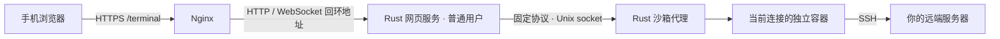

# STRGO 账号终端

2026-10-22：新版使用 AI 生图同一套账号与 7 天持久登录，首次进入直接打开个人 Linux 工作区。页面采用微信式会话列表，支持最多 8 个窗口独立运行、切换、草稿保留、复制粘贴、聊天导出、重命名与重新连接；SSH 连接保留为高级入口。

- [需求文档](REQUIREMENTS.md)：v1.1，先完成需求再开发。
- [产品核查](PRODUCT-REVIEW.md)：独立产品代理完成两轮评审，源码与离线验收通过，非真人产品签字。
- [当前使用、升级与验收](ACCOUNT-TERMINAL.md)：共享账号、工作区边界、构建、回滚和容量管理。
- [本次验证记录](ACCOUNT-VERIFICATION.md)：167 项离线用例通过，列明真实环境待验收项。

当前入口仍为 `/terminal/`。默认工作区为普通用户、无网络的隔离容器；只持久保留该账号工作目录，连接最长默认 1 小时，断开后进程结束。SSH 仍需目标服务器自己的认证，服务级私钥只提供给管理员。**旧访问口令不再用于新版认证。**

本次未改动线上服务；真实浏览器、Docker 工作区与 WebSocket 端到端仍待具备相应权限的环境验收。升级现有部署应使用 `update-account.sh`，同时更新账号接口和两个终端服务。

## 旧版 SSH 架构与安装记录（归档）

以下内容保留旧版背景，其中口令登录、8 小时登录、单窗口和旧发布状态不适用于当前账号版本；当前操作以 [ACCOUNT-TERMINAL.md](ACCOUNT-TERMINAL.md) 为准。

公开入口为 **https://strgo.com/terminal**。Rust 实现网页服务、WebSocket、登录会话、PTY 数据桥接和沙箱代理；本地打包的 xterm.js 负责浏览器终端显示，SSH 协议由沙箱内的 OpenSSH 客户端处理。手机和电脑都可用，支持 vim、top、tmux、中文输入、方向键、Tab、Ctrl+C 和窗口尺寸调整。

用户已确定采用**每个 SSH 连接一个独立容器**。关闭连接、退出网页登录或会话超时后销毁容器；重启代理时清理带本项目标签的残留容器。默认最多 8 个会话，每个最多 1 小时。



网页服务不接触 Docker socket，代理验证地址、用户名、端口与消息长度，并通过参数数组启动容器。容器使用普通 UID 10001、只读根文件系统、临时内存目录、独立网络/进程空间、移除全部 capabilities、禁止提权，并限制 128 MiB 内存、0.5 CPU 和 32 个进程。不挂载网站目录、宿主机 SSH 目录或 Docker socket。容器间通信关闭。

沙箱隔离的是运行 SSH 客户端的本站环境。登录后执行的命令仍然运行在所连接的 SSH 服务器；断开会清除本地沙箱，远端持久会话可使用 tmux 保留。

## 部署到现有 STRGO 站点

在服务器普通 SSH 或阿里云 Workbench 终端中以 root 执行统一发布脚本：

```bash
bash /root/.codex/strgo-terminal/publish.sh
```

脚本依赖现有 `/etc/nginx/sites-available/strgo.conf`。2026-10-10 已通过普通服务器终端完成主站 HTTPS，当前仍缺少终端程序、两个服务和 Nginx 路由，所以 `/terminal` 还不可访问。此前发布被 Docker Hub 基础镜像下载超时阻断；默认构建方式已调整为不依赖 Docker Hub。

`publish.sh` 会先处理缺少的 HTTPS，再调用 `deploy.sh` 构建并发布终端。若没有证书，它会在终端内提示输入邮箱，并说明输入邮箱表示同意 Let's Encrypt 服务条款；取得证书后保留现有主页文件和页面配置，仅加入 HTTPS listener 与 HTTP 跳转。启用后验证原主页响应；失败时恢复原主站配置。云安全组需放行入站 TCP 443。

也可提供邮箱以非交互方式申请证书，此参数表示同意 Let's Encrypt 服务条款：

```bash
bash /root/.codex/strgo-terminal/publish.sh --email 你的邮箱
```

HTTPS 已正常运行时，可直接执行 `deploy.sh`。只查看安装条件、不修改系统：`bash publish.sh --check`。这个检查核对安装文件，实际服务与路由验证由发布流程执行。

部署脚本默认在项目 `.build/` 中安装 Rust 1.88.0 工具链，用镜像源获取 crate 并运行 Rust 单元测试、编译程序；通过 Python 下载和校验固定版本的 xterm 前端包，无需 Node 基础镜像。之后下载并校验 Alpine 3.21 系列镜像目录中可用的稳定根文件系统，以 `FROM scratch` 构建 OpenSSH 容器镜像。此流程不会向 Docker Hub 拉取基础镜像，不修改全局 Docker、Rust 或 npm 配置。运行时仍然每个 SSH 连接一个独立容器。

创建容器网络后运行真实容器检查用户权限、只读目录、禁止提权和资源限制。随后创建服务账户、生成随机访问口令、安装两个 systemd 服务，再加入独立 Nginx 配置片段。检查认证、WebSocket 和代理地址拒绝规则后才接入公开路由；接入后核对本机 HTTPS 返回的页面。更新保留访问口令、配置及锁文件；失败时恢复 Nginx 配置、二进制、环境文件与原有服务。升级会结束当前 SSH 沙箱会话。

遇到 Docker Hub `registry-1.docker.io ... i/o timeout` 时，使用更新后的默认构建路径继续发布：

```bash
bash /root/.codex/strgo-terminal/publish.sh --build-mode native
```

本地构建会下载工具链和依赖，首次执行需要一定时间及磁盘空间。下载默认使用下列配置，可通过环境变量替换为自己能访问的 HTTPS 源：

| 环境变量 | 默认值 |
| --- | --- |
| `TERMINAL_RUSTUP_DIST_SERVER` | `https://rsproxy.cn` |
| `TERMINAL_RUSTUP_UPDATE_ROOT` | `https://rsproxy.cn/rustup` |
| `TERMINAL_CARGO_REGISTRY` | `sparse+https://rsproxy.cn/index/` |
| `TERMINAL_NPM_REGISTRY` | `https://registry.npmmirror.com` |
| `TERMINAL_ALPINE_MIRROR` | `https://mirrors.tuna.tsinghua.edu.cn/alpine` |

工具链和 Alpine 下载校验 SHA-256，npm 包校验元数据中的 SHA-512，资源提取只写固定的目标文件。Alpine 软件包通过 APK 自身签名验证。所有来源都强制 HTTPS，下载失败会退出；未在当前受限 Codex 环境中验证这些源的实时可达性。

有可访问的基础镜像仓库时，也保留原来的 Docker 构建方式：

```bash
bash /root/.codex/strgo-terminal/publish.sh --build-mode docker --image-prefix 你的镜像仓库/library
```

仓库需提供 `rust:1.88-bullseye`、`node:22-bookworm-slim` 和 `alpine:3.21`。该选项只指定此次构建的基础镜像来源，不重启 Docker 或修改主机其他容器。

部署成功后，在服务器私下查看访问口令：

```bash
sudo sed -n 's/^TERMINAL_ACCESS_TOKEN=//p' /etc/strgo-terminal/web.env
```

手机打开 `https://strgo.com/terminal`，输入这个访问口令，再填写目标服务器地址、用户名和 SSH 端口。第一次连接会显示主机指纹，核对后输入 `yes` 并发送；随后输入 SSH 密码。下方输入栏支持中文整行发送，可点「隐藏输入」遮住密码。也可以直接使用终端的键盘输入。服务器指纹文件属于当前沙箱，重新连接需要再次核对。

若使用密钥认证，可在部署时指定**服务器管理员提供的私钥**：

```bash
bash /root/.codex/strgo-terminal/publish.sh --identity /绝对路径/id_ed25519
```

它只将该单个文件只读挂载进沙箱的固定位置，网页用户不能选择宿主机文件或其他挂载路径。带口令的私钥在终端内输入口令。配置一把服务级密钥意味着有访问口令的用户都能使用这把密钥，因此该服务适合你的个人终端。

网页只在用户勾选后保存地址、用户名与端口；访问口令和 SSH 密码不写入浏览器存储，终端输入/输出不写日志，Docker 会话日志也关闭。网页登录使用 HttpOnly、Secure、SameSite=Strict cookie，8 小时有效；代理重启、网页服务重启后需重新连接，网页服务重启还需重新登录。

## 文件与维护

| 文件 / 地址 | 用途 |
| --- | --- |
| `src/web.rs` | 登录、页面、WebSocket；默认只监听 `127.0.0.1:3081` |
| `src/broker.rs` | 有限的 Docker 操作、目标地址验证、PTY、清理 |
| `src/protocol.rs` | 网页与代理间的消息和限制 |
| `web/` | 手机界面及构建时准备的本地 xterm 资源 |
| `/etc/strgo-terminal/web.env` | 网页服务访问口令与来源设置，root 可读 |
| `/etc/strgo-terminal/broker.env` | 沙箱镜像、网络、限额与地址策略 |
| `/etc/nginx/snippets/strgo-terminal.conf` | 仅代理 `/terminal/` 的独立配置 |
| `/run/strgo-terminal/broker.sock` | 仅 root 和终端服务组可以访问的代理接口 |

默认限制回环、链路本地、云元数据、私有网段以及部署时记录的本站地址。连接本站公网 IP 时，旧版会显示“此地址位于终端服务禁止访问的网段”。新版改为显示具体 IP、端口与拦截原因，并支持管理员只放行一个 SSH 地址和端口。

连接 `strgo.com` 本机 SSH（端口 22）时，在普通服务器终端执行：

```bash
bash /root/.codex/strgo-terminal/allow-ssh.sh strgo.com 22
```

要连接其他内网或受限服务器，改成其实际 IP 或域名与 SSH 端口：

```bash
bash /root/.codex/strgo-terminal/allow-ssh.sh 10.0.0.5 2222
```

脚本解析目标域名，生成 `TERMINAL_ALLOWED_TARGETS` 的固定 IP 与端口条目。它利用已经安装的 Rust 工具链与依赖缓存离线测试、编译修复，备份程序和配置，再更新并重启两个终端服务。无需重新下载依赖、构建 Docker 镜像或配置 HTTPS；失败会恢复程序及地址配置。当前终端会话会结束，之后需重新输入网页访问口令。目标 SSH 服务器仍需可达且通过自己的用户认证。

`TERMINAL_ALLOWED_TARGETS=47.108.255.179:22` 可以只放行本站 SSH，`TERMINAL_ALLOWED_TARGETS=10.0.0.5:2222,[fc00::2]:22` 可以放行指定内网目标。明确的 IP＋端口例外优先于本站禁止列表及内网默认限制，其余端口不受影响；回环、云元数据、链路本地和特殊保留地址始终不能放行。域名记录变化后重新运行 `allow-ssh.sh`，并由管理员清理不再需要的旧例外。

代理只把经验证的数字 IP 交给 SSH。一个域名同时返回受限与可用 IP 时，选择其中符合当前规则的地址；SSH 不会再次解析并选到受限地址。`TERMINAL_ALLOW_PRIVATE=1` 仍可用于允许一般内网目标，但精确例外更便于限制范围。更换本站 IP 后也应更新 `TERMINAL_BLOCKED_IPS`。

```bash
systemctl status strgo-terminal strgo-terminal-broker
journalctl -u strgo-terminal -u strgo-terminal-broker -n 80 --no-pager
python3 /root/.codex/strgo-terminal/tests/smoke.py --env /etc/strgo-terminal/web.env
docker ps --filter label=com.strgo.terminal.sandbox=1
```

主站部署脚本已补充对终端片段的保留逻辑，之后更新主站时会继续包含 `/terminal`。终端程序、私钥和配置位于静态网站公开目录之外。

## 开发与检查

需要 Rust 1.88+、Node.js 22、Linux 和 Docker。浏览器资源在编译前准备，运行期间不访问 CDN：

```bash
cd /root/.codex/strgo-terminal
npm install --ignore-scripts --no-audit
npm run assets
cargo generate-lockfile
cargo test --locked
node tests/ui.test.mjs
python3 tests/check-files.py
python3 -m unittest discover -s tests -p 'test_*.py'
bash -n publish.sh deploy.sh allow-ssh.sh scripts/build-native.sh scripts/cleanup.sh tests/sandbox-check.sh
```

首次联网构建会生成 Cargo.lock；npm 开发流程及 Docker 构建模式还会生成 package-lock.json，后续提交时请一起提交。本地部署的 Python 资源下载保留 `.build/downloads/npm/asset-integrity.json`，记录固定版本及实际校验值。主要依赖版本已固定。

Rust 单元测试覆盖命令参数注入、网段限制、消息大小、窗口尺寸和 cookie；离线 JavaScript 测试覆盖手机输入法、快捷键、UTF-8 分段、访问验证、退出/重连、存储拒绝和剪贴板降级；Python 测试覆盖下载校验、包版本、归档路径、Alpine 可用版本选择和 Nginx/HTTPS 配置升级。`tests/smoke.py` 在运行服务上检查真实 HTTP/WebSocket 与代理链路。真实 SSH 登录、窗口调整及断开后的容器清理，需要部署后使用自己的 SSH 服务器检查。

如需真实浏览器检查，在允许启动 Chromium 的环境安装 Playwright，再运行：

```bash
npm install --no-save playwright
npx playwright install chromium
node tests/browser-check.mjs
```

它检查桌面/手机横向溢出、访问验证状态和真实 xterm 渲染，并生成截图；不会登录或执行远端命令。

## 当前交付状态

截至 2026-10-10，用户已在普通服务器终端安装终端；本次确认程序、服务配置、工具链及编译缓存已经存在，用户能够进入连接流程。此前的地址规则误拦了连接本站 SSH 的用途，现已加入管理员按 IP 与端口放行的修复。已通过 13 项 Rust 单元测试并离线构建新版程序；当前会话仍无法使用系统网络或写入系统目录，因此**修复尚未安装到运行中的服务，真实 SSH 登录仍需验证**。在普通服务器终端执行 `allow-ssh.sh` 完成修复安装。验证详情见 `VERIFICATION.md`。

