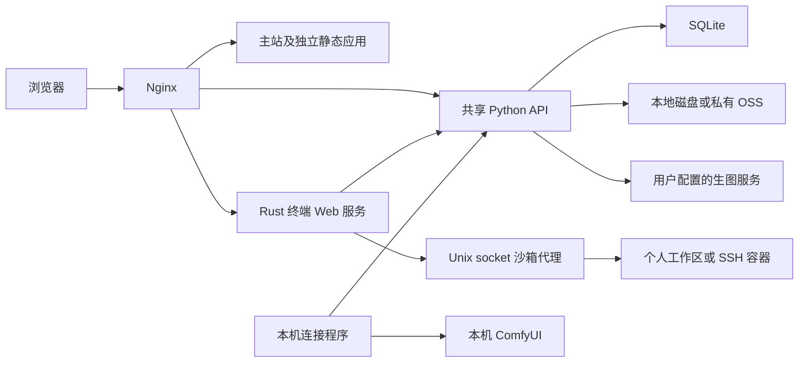

# 架构与模块

本仓库是主站和六个应用的统一源码仓库，各应用保留自己的依赖锁文件、构建、测试与发布流程。当前路径以仓库根目录为起点。

## 模块归属

| 模块 | 源码 | 构建或运行方式 |
| --- | --- | --- |
| 主站、卧室、舞台、作品介绍 | `src/`、`content/`、`content_build.py`、`site.json` | `build.py` 生成根目录 `dist/` |
| 生图工作台 | `src/image-playground/` | 随主站发布；请求 `/api/image/` |
| 会员社区 | `src/forum/` | 随主站发布；共享账号 API |
| 管理员创作台 | `src/local-studio/` | 随主站构建；独立 Workflow 域名与 Cookie |
| AI 音乐、对话、助手与管理后台 | `src/ai-workspace/`、`image_service/ai_*.py` | 根构建生成 `/ai/`、`/admin/ai/`，共享后端提供 `/api/ai/v1/` |
| 全站后台 | `src/admin/`、`image_service/admin.py` | `/admin/`、共享账号管理员、账号/内容/运行摘要及审计 |
| 账号、生图、社区、工作流 API | `image_service/` | Python、SQLite、加密存储，默认回环端口 8092 |
| DREAMS | `apps/dreams/` | 独立构建，再同步到 `src/dreams/`，由主站发布 |
| NEXUS | `apps/nexus/`、主站副本 `src/nexus/` | 独立工程和集成副本同时存在；主站构建读取集成副本 |
| POLYVERSE | `apps/polyverse/` | 独立静态构建和 `/polyverse/` 发布目录 |
| MEOW | `apps/meow/` | 独立静态构建和 `/meow/` 发布目录 |
| SWARMERA | `apps/swarmera/` | 独立静态构建和 `/swarmera/` 发布目录 |
| 账号终端、SSH 沙箱 | `apps/terminal/` | Rust Web 服务、Unix socket 代理与 Docker；前端使用本地 xterm |

主站保持 HTML/CSS/JavaScript 和 Python 静态构建；不能仅凭根依赖中存在 React 就推断主站使用 React 框架。3D 应用使用本地 Three.js 资源和程序化模型。

## 请求与数据

生图、论坛和终端使用共享账号会话；Workflow 使用独立登录 Cookie，并限制管理员。终端按账号分配持久化工作区卷，浏览器不能指定其他账号的卷名。SSH 的外网访问策略与离线个人工作区是两条独立路径。

收费生图任务在模型调用中断后不会自动重新调用；已生成图片的上传重试与模型重生成有不同含义。Workflow 通过主动 HTTPS 轮询连接服务器，本机 ComfyUI 保持回环地址；重启与断线恢复使用已有任务记录，避免重复提交。

账号、配置和结果恢复依赖数据库、持久化文件与原加密密钥。静态 `dist/`、运行数据和密钥不应当作为源码提交。备份和恢复细节见 [生图说明](../IMAGE-PLAYGROUND.md) 与 [Workflow](../WORKFLOW.md)。

AI 空间另有模块/模型授权、TOTP 管理验证、额度与预算预占、任务结算、SSE 和私有音频。管理员身份不自动获得 AI 使用权。AI本地模型与ComfyUI Workflow共用中央资源组锁；Workflow结果保存后仍需连接程序确认队列空闲和模型卸载才能释放。真实硬件共享前须验证各模型卸载策略，未验收时保持硬件隔离或错峰；参见 [GPU调度](GPU-SCHEDULING.md)、[AI接入](../AI-WORKSPACE.md)与[实现契约](ai/implementation.md)。

## 构建和发布边界

- 根构建复制 `src/dreams/`、`src/nexus/`，不会自动构建全部 `apps/`。
- DREAMS 修改后运行其构建和 `scripts/sync-strgo.mjs`，再构建主站；同步脚本先准备完整内容，校验成功后替换集成目录。
- NEXUS修改独立工程后运行 `node apps/nexus/scripts/sync-strgo.mjs`，通过 `--check` 确认集成副本一致，再构建主站；同步失败保留原目录。
- 根预览服务将三条独立应用路由挂载到 `apps/<应用名>/dist`，缺少该应用构建时返回 404。
- 生产发布按 [统一部署](../DEPLOYMENT.md) 执行，保留已有服务的配置片段、数据目录及版本回滚机制。GitHub 提交本身不代表网站已经发布。
