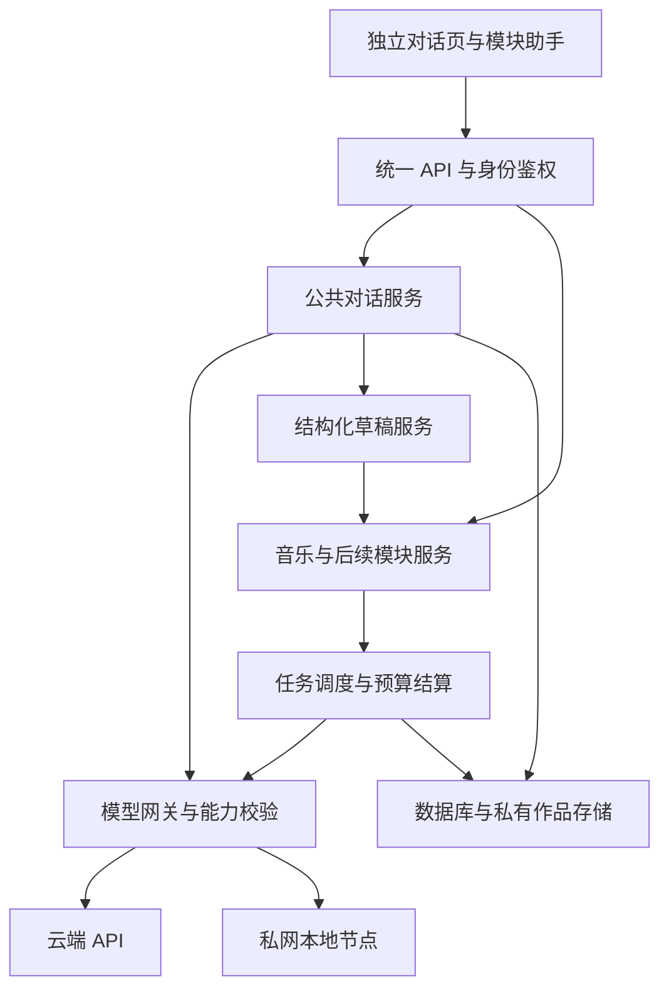
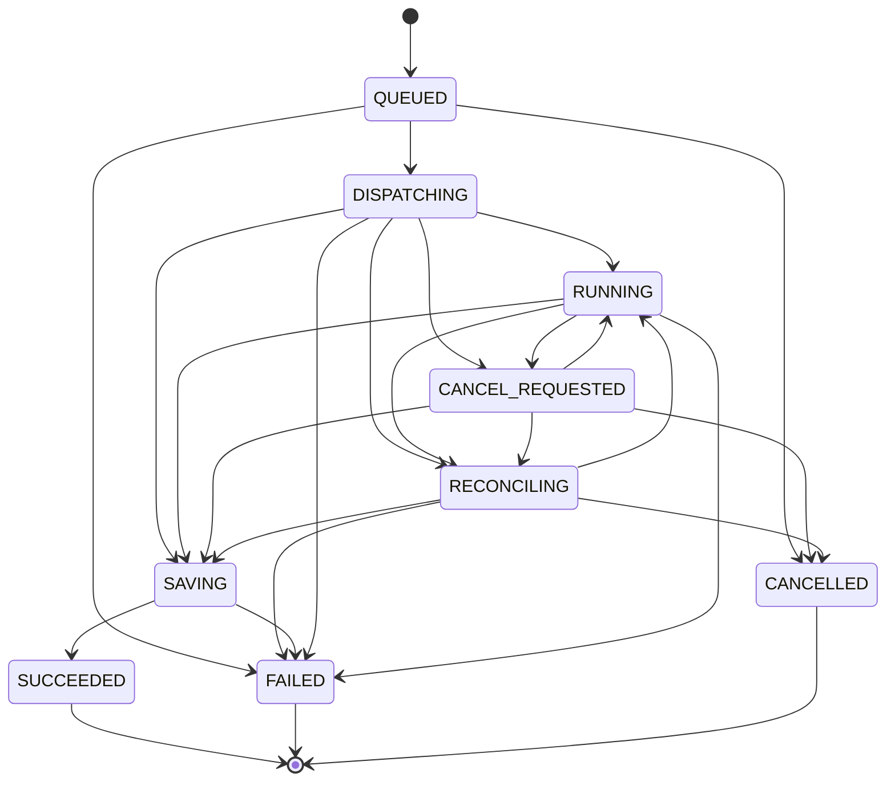

# strgo 网站 AI 模块设计与顺序开发文档

版本 1.0　｜　日期 2026年10月22日　｜　适用对象 网站负责人及后续开发者

本文定义 strgo.com 的 AI 音乐生成、简单对话、访问权限、云端 API 和本地模型接入方案。对话能力作为网站公共能力建设，同时服务独立聊天页、音乐创作助手和未来的生图等模块。开发者按第十六章任务顺序实现，并用第十七章闭环矩阵和第十八章验收用例核对结果。

首期采用独立 AI 前端入口、模块化后端、数据库任务队列和统一模型网关。先完成身份与权限、模型配置、可复用对话，再完成音乐生成和两者集成。保留已有网站入口；将新能力接入现有工程，不要求重建个人主页。本文中的容量、额度和保留期是可配置的初始值，不是对现网规模或模型性能的承诺。

## 文档导航

1. 目标与实施基线
2. 页面与用户操作
3. 系统结构与模块边界
4. 账号与权限
5. 可复用对话能力
6. 后续模块接入契约
7. 云端 API 与模型配置
8. 本地模型与计算节点
9. 音乐生成与任务生命周期
10. 额度与费用控制
11. 数据结构与一致性约束
12. 接口与事件契约
13. 管理后台与配置生效
14. 数据保护与运行约束
15. 部署与维护
16. 按序开发任务
17. 设计闭环检查
18. 验收用例与发布条件
19. 配置基线与待核对事项
20. 开发交接与资料来源

## 一 目标与实施基线

### 首期交付范围

| 编号 | 要求 | 完成标准 |
| --- | --- | --- |
| R01 | 权限访问 | 登录、模块授权、模型授权和资源归属都由后端检查 |
| R02 | 简单对话 | 文本多轮对话、流式回复、停止、历史和失败恢复 |
| R03 | 对话复用 | 独立页和音乐页共用服务、会话协议与组件 |
| R04 | 音乐生成 | 纯音乐或用户歌词输入、异步生成、播放、下载、历史 |
| R05 | 云端接入 | 至少一个真实文本 API 和一个真实音乐 API 通过验收 |
| R06 | 本地接入 | 本地文本服务和本地音乐服务经过私有网络供网站调用 |
| R07 | 管理配置 | 管理员配置供应商、模型、密钥、授权、额度及停用 |
| R08 | 成本控制 | 并发限制、额度预占、预算上限、失败结算和对账 |
| R09 | 结果可靠性 | 重复提交不重复建单，刷新页面可恢复，结果存入自有存储 |
| R10 | 后续扩展 | 生图模块按契约接入，不复制对话或权限实现 |
| R11 | 私有内容 | 默认本人可见，跨用户引用与下载被拒绝 |
| R12 | 可运营 | 有健康状态、审计、告警、备份恢复及回滚说明 |

首期不开发支付充值、开放注册、共享团队空间、公开作品社区、语音对话、知识库检索或自动执行多步智能体。生图首期交付接入契约和模拟模块验收，不包含真实生图功能；真实生图作为后续模块实现。上述取舍用于固定实现范围。

### 默认工程方案

新增服务建议采用 TypeScript、React、NestJS、PostgreSQL、兼容 S3 的私有对象存储和 Python 推理服务。已有前端可以保持原框架，通过同源路由接入独立构建的 AI 页面。后端采用模块化单体，API 与 Worker 分进程运行；初期使用 PostgreSQL 任务表和 SKIP LOCKED 领取任务，不额外引入 Redis 或消息集群。

这一选择适合个人网站的首期建设：权限、用量和任务状态都在同一数据库内完成事务。将来增加队列服务时，数据库任务仍是事实来源，通过 outbox 投递任务编号，不能让队列成为唯一状态来源。数据库不可用时停止新生成请求。

已有工程若具备成熟账号系统、任务服务或兼容存储，优先复用，并在 P00 输出字段及接口映射。禁止为接入 AI 建立两个互不关联的用户身份。本文默认所有账号与作品归属一个用户，workspace_scope 固定为 personal；组织与团队共享另行设计。

### 关键决策

| 决策 | 首期规则 |
| --- | --- |
| 账号来源 | 优先沿用站点账号；没有账号时采用管理员邀请与密码登录 |
| 初次授权 | 新账号没有 AI 使用权，管理员按模块和模型分别授权 |
| 对话定位 | 公共 ConversationService 与可嵌入 AssistantPanel |
| 对话与生成 | 对话形成草稿，用户确认后调用模块正常生成接口 |
| 提供方配置 | 平台管理员管理密钥；首期不提供个人自带密钥 |
| 本地地址 | 指服务器可经私网访问的计算节点，不是浏览器的 localhost |
| 模型切换 | 运行开始时固定模型与配置版本；新运行使用新配置 |
| 失败降级 | 本地到云端必须重新展示数据去向和费用，不能静默切换 |
| 计量方式 | 使用次数、生成秒数、文本输出上限和平台预算，首期不涉及收款 |
| 内容归属 | 默认私有，无公开链接；管理员不默认读取用户正文 |

## 二 页面与用户操作

### 路由

| 路由 | 页面 | 访问条件 |
| --- | --- | --- |
| /ai | AI 工具入口与本人额度 | 登录；按授权展示可用模块 |
| /ai/chat | 独立对话工作台 | chat.use |
| /ai/music | 音乐生成与创作助手 | music.generate；助手另外需要 chat.use |
| /ai/tasks | 本人的生成任务 | 登录，资源必须归本人 |
| /ai/assets | 本人的音乐等作品 | 登录，资源必须归本人 |
| /ai/settings | 本人会话和数据设置 | 登录 |
| /ai/login | 登录与邀请激活 | 未登录可访问 |
| /admin/ai | 模型、权限、额度与节点管理 | 对应管理权限 |
| /ai/images | 后续生图入口 | 首期不注册可访问页面 |

API 统一使用 /api/ai/v1。P00 检查该前缀与现有 /ai 路由是否冲突，冲突时整体配置前缀并更新契约。所有 return_to 只接受站内允许路径，阻止外部跳转。现有主页、终端和其他路由的回归结果列入发布条件。

### 音乐页

桌面端以音乐表单、任务结果和可收起的对话侧栏组织；手机端以抽屉显示助手，输入草稿在切换标签和刷新后恢复。表单包括作品标题、模式、风格描述、歌词、期望时长、生成模型和可选高级参数。模型能力决定显示哪些高级参数，不支持的字段禁用并说明原因。

提交前展示所选模型、数据将发送到本地或云端、本次额度、预计费用上限和排队提示。点击生成才建立任务。作品卡片显示真实状态、模型、时长、创建时间及播放、下载、复用参数、删除操作。生成没有可核实进度时只显示阶段，不显示虚构百分比。

助手可执行“写歌词”“修改这一段歌词”“生成风格描述”“解释参数”“整理成生成草稿”。回复下提供“预览更改”和“应用到表单”。应用仅修改表单，不自动开始音乐生成。没有 chat.use 时音乐页依然允许手动填写和生成，助手显示需授权状态。

### 共享交互状态

| 状态 | 页面行为 | 可恢复操作 |
| --- | --- | --- |
| 未登录 | 跳转登录并保留安全的返回路径 | 登录后返回原模块 |
| 未授权 | 展示模块说明及站内权限申请 | 查看申请状态 |
| 模型未配置 | 展示当前无可用模型 | 管理员进入配置页 |
| 本地离线 | 禁用该节点新提交，保留编辑内容 | 手动选择其他已授权模型 |
| 额度不足 | 提示额度项目与重置时间 | 申请额度或等待重置 |
| 排队或运行 | 显示任务编号和阶段 | 刷新恢复、申请取消 |
| 状态待核实 | 提示上游可能已接收，暂勿重复生成 | 后台核实或显式新建 |
| 已完成 | 播放、下载、复用参数 | 链接过期时重新鉴权取链接 |
| 失败 | 提示可公开的错误与处理建议 | 修正参数后新建，不能原地重复扣额 |

权限申请保存在站内，由管理员在后台批准或拒绝，不依赖邮件或消息服务。用户可查看申请结果；重复未处理的同模块申请合并。

## 三 系统结构与模块边界

### 公共能力结构



图中草稿到模块的连接代表经过用户确认的调用。模型不能绕过 API 直接操作数据库、文件或计费接口。网页只连接本站后端，供应商密钥和计算节点凭证不进入网页。

### 服务职责

| 服务 | 职责 | 关键边界 |
| --- | --- | --- |
| IdentityService | 登录会话、用户状态、授权与申请 | 不从请求正文读取可信 user_id |
| PolicyService | 模块、模型、资源和操作权限 | 每次服务调用与任务领取时检查 |
| ConversationService | 会话、运行、历史、上下文、事件 | 不依赖音乐表单或具体前端框架 |
| DraftService | 模块草稿、校验、版本及应用记录 | 不自动生成作品 |
| ModuleRegistry | 模块元数据、提示模板与能力声明 | 注册来自受审代码，不接收用户执行代码 |
| ModelGateway | 请求规范化、提供方适配、超时与用量 | 不承担用户授权，入口仍需 PolicyService |
| JobService | 异步任务、领取、取消、恢复与结果落盘 | 数据库持久化先于外部调用 |
| QuotaService | 原子预占、结算、预算及对账 | 与创建运行或任务使用同一事务 |
| AssetService | 私有作品、下载、留存及删除 | 不直接返回本地路径或长期公开 URL |
| AdminService | 模型配置、密钥、节点、审计与审批 | 管理权限分开，正文默认不可读 |

### 推荐工程组织

建议在现有仓库中加入 apps/ai-web、apps/ai-api、apps/ai-worker，以及 packages/ai-contracts、packages/ai-client、packages/assistant-ui、packages/module-registry。已有站点工程可以作为宿主。独立运行也必须调用相同公共 API，不能在音乐页内另写一套对话接口。

ai-contracts 定义 JSON Schema、DTO、事件名、错误码和版本；ai-client 封装 HTTP、事件重连及取消；assistant-ui 只负责展示和用户交互；模块注册文件和模型适配器放在后端。Python 只运行本地推理和轻量网关，不承担网站用户鉴权。

## 四 账号与权限

### 授权模型

一次生成必须同时满足：账号 active、会话有效、模块操作许可有效、模型在用户授权集合内、模型支持请求能力、资源属于当前用户、未超过并发与额度、系统及模型可用。任何条件不满足都拒绝，前端隐藏按钮不能替代校验。

权限拆为后台管理权与业务使用权。角色只提供初始权限集合；模块授权、模型授权和到期时间单独记录。系统配置和管理员权限也不能使某个任务跳过预算控制。管理员以普通用户身份生成时仍需使用授权。

| 操作 | 访客 | 成员 | 管理员 |
| --- | --- | --- | --- |
| 查看公开模块说明 | 允许 | 允许 | 允许 |
| 文本对话 | 拒绝 | 需 chat.use | 需 chat.use |
| 音乐生成 | 拒绝 | 需 music.generate | 需 music.generate |
| 音乐页使用助手 | 拒绝 | 同时需 chat.use 与 music.generate | 同样检查 |
| 查看下载本人作品 | 拒绝 | 允许，账号 active | 仅本人 |
| 查看其他人的正文 | 拒绝 | 拒绝 | 默认拒绝 |
| 配置模型与密钥 | 拒绝 | 拒绝 | 需 provider.manage |
| 配置授权与额度 | 拒绝 | 拒绝 | 需 access.manage |
| 查看脱敏审计 | 拒绝 | 拒绝 | 需 audit.read |

使用权限键为 chat.use、music.generate，后续加入 image.generate。资源读写采用 own 范围检查。模型授权键使用内部 model_id，可按模块给出允许列表；不能因为模型出现在下拉框里就直接认为用户可调用。

撤销模块或模型授权后，拒绝新运行及未发出的排队任务；已发到上游的运行执行尽力停止，并按真实消耗结算。仍 active 的用户可以查看和删除历史及下载本人已有作品，以免撤权造成数据无法取回。封禁账号撤销全部会话并拒绝访问。此处区分撤销使用权与封禁账号。

### 登录与账号生命周期

若已有账号系统，新增表引用其稳定主体标识，并通过服务端适配器取得身份。不得直接接受客户端写入的权限或角色。没有账号系统时，管理员用部署 CLI 创建首个账号；页面不提供“自动成为管理员”。管理员发放一次性邀请链接，令牌只存哈希，24小时有效，使用后失效；成员设置密码后仍需获得 AI 授权。

密码使用 Argon2id 等成熟库保存哈希，具体参数在目标服务器基准测试后固定。采用数据库保存的随机不透明会话令牌，Cookie 为 Secure、HttpOnly、SameSite=Lax、Path=/，使用独立 __Host-strgo-ai-session 名称，不设置 Domain。写接口验证 Origin 与 CSRF 令牌。会话最长7天，闲置24小时过期，密码或权限变更后更新 auth_version，封禁立即吊销。

失败登录按账号和 IP 双重限速，避免仅凭 IP 永久锁死用户。无邮件服务时，密码重置由管理员发放一次性重置链接，30分钟有效；管理员丢失登录可使用受服务器权限保护的 CLI 恢复，操作写入审计。首期后台启用 TOTP，并由 CLI 在验证服务器身份后恢复；备份恢复不能重新启用已吊销的旧会话。

### 资源隔离

会话、消息、运行、草稿、任务、作品、申请和事件都携带 owner_id。查询条件必须绑定 owner_id；对他人资源返回404。管理接口也需要独立权限，不能仅靠 /admin 路由前缀。事件订阅、音频 Range 请求和重新签名下载都重复执行资源鉴权。

授权在数据库读取，或者用不超过5秒且可主动失效的缓存。运行中至少每5秒检查封禁和撤权，取消待执行动作。模型生成的文字、JSON 或工具请求都不能修改权限。

## 五 可复用对话能力

### 三层复用

对话分为服务层、无界面客户端层和展示层。ConversationService 向所有模块提供同一套会话与运行 API。ai-client 提供 createConversation、startRun、subscribeEvents、cancelRun、createDraft 与 applyDraft；只传入本站会话凭证，不接收供应商密钥。AssistantPanel 作为 React 组件提供侧栏、抽屉和完整页面三种布局。非 React 页面也能直接使用 ai-client 或 HTTP API。

独立聊天页与音乐助手共享服务，但默认使用不同会话。会话绑定 scope_module 和可选 scope_resource_id，创建后不可改归属。global 会话不会自动读到音乐或图片内容；用户选择“带入此模块”时，在目标模块创建新会话并引用用户选中的内容，原会话保持原范围。

### 会话与运行

conversation 是有归属的消息容器，run 是一次模型请求。用户每次发送消息创建一个 run。客户端只发送 text、内部 model_id、expected_conversation_revision 和经许可的 context_refs；system prompt、消息 role、供应商地址及完整上下文都由服务端构建。

同一会话只允许一个活动 run。双标签同时发送时，后到请求返回409 CONVERSATION_BUSY；会话版本过旧返回409 VERSION_CONFLICT。用户可新建会话并行。历史首期为单条线性链，重试产生新 run 并记录 retry_of_run_id；失败或中止的回复不自动加入下一轮模型历史，用户明确选用时才能作为引用内容。

run 状态为 QUEUED、RUNNING、SUCCEEDED、FAILED、CANCELLED、INTERRUPTED。部分文本属于持久化消息，具有 partial 标志；只有成功提交的回复进入正常历史。stop 是明确取消操作，关闭页面或事件断连不代表取消，运行继续到期限，用户刷新可恢复。服务进程意外退出时，无上游可恢复标识的运行设为 INTERRUPTED，禁止自动再生成整段回复。

### 上下文构建

上下文依次为公共系统模板、模块 profile、用户本轮文字、该会话成功历史、用户明确选中的表单或作品摘要。模块数据作为不可信引用块附上类型与来源，不提升为 system 指令。每条引用包含 resource_id、resource_version、selected_fields 和用户确认的数据去向。

ContextResolver 先检查资源归属及模块权限，再按照模块允许字段提取快照。首期只使用文本、表单和任务摘要；不把图片、音频原文件自动发送给文本模型。未来多模态模型必须显式具备相应能力，并展示传输提示。

上下文总预算取所选模型已验证上下文上限与平台上限中的较小值，初始平台上限为16000 token，输出上限为2048 token。预留系统和输出预算，先删除最旧完整轮次；仍超限则返回 CONTEXT_TOO_LARGE，提示用户精简。首期不自动调用模型总结历史，避免产生未展示的额外请求与费用。最新用户消息和必需模块约束不得被静默截断。

分词器可用时使用对应分词器；不可用时采用适配器提供的保守估算并显示 estimated 标记，不把估算宣称为准确 token。模板、引用内容和模型配置版本保存在 run 快照中，方便复现处理过程。不得存储或展示供应商隐藏推理内容。

### 流式输出与恢复

先通过 POST 创建运行并返回202和 run_id，再通过 GET /chat/runs/{id}/events 建立 SSE。事件有严格递增 seq 和格式版本 v。Worker 按时间或字符批量把增量落库，同一事务更新消息已保存文本、last_seq 和事件日志，提交后才发布；客户端按 seq 去重。终态事件必须包含 final_message_id，界面再取完整消息确认。

断连后用 Last-Event-ID 或 after_seq 续读；两者冲突返回400。服务端先重放再跟进实时事件，不重新请求模型。已压缩删除的旧增量返回410 EVENT_CURSOR_EXPIRED，客户端读取运行快照和完整已保存文本，然后从新的 seq 继续。SSE 心跳15秒，不缓存，不压缩缓冲；授权撤销时关闭连接。代理连接超时要长于心跳间隔。

客户端最后未收到 done 时不能直接认定失败；应查询 run 状态。若数据库暂时故障，停止上游读取并尽力取消，恢复后标记 INTERRUPTED，避免继续输出无法恢复的文字。

### 模块创作助手

音乐助手的 profile 只包含音乐字段说明和允许产出的草稿类型；生图助手以后换成 image profile。允许操作由服务端根据用户权限与模块注册信息计算。首期支持普通回复和“生成结构化草稿”，不让模型主动调用产生费用的音乐、生图或删除接口。

生成草稿也属于一次受 chat.use 控制的文本模型运行，消耗聊天额度。音乐助手的草稿还必须检查 music.generate；没有音乐使用权的人可以在独立聊天中讨论音乐，但不能取得受控音乐资源或执行模块操作。

结构化输出可用时要求对应 JSON Schema；不支持时采用严格 JSON 提取和本地校验。输出非法时返回 DRAFT_INVALID 并保留普通回复，用户可编辑或重新请求；不自动无限重试修复。生成接口只接受经过校验的 DTO，不接受模型输出的 URL、命令、角色或任意工具名称。

## 六 后续模块接入契约

### 模块注册

每个模块在受版本控制的代码中注册 ModuleDescriptor，包括 id、contract_version、route、use_permission、context_schema、draft_schema、profile_version、allowed_actions、resolve_context、validate_draft、apply_draft 和 subscribe_result。首期注册 chat 与 music；image 使用测试替身验证接口，不向用户发布。

ModuleDescriptor 不承担模型连接。所有模块调用 ModelGateway、QuotaService 和 AssetService；后续模块不得复制用户管理、模型密钥、会话历史或对话窗口代码。前端只获取可公开的模块能力描述，函数实现和系统模板不下发。

### 通用草稿格式

```json
{
  "schema_version": "1.0",
  "module_id": "music",
  "kind": "music.generate_draft",
  "target_resource_id": "019a0940-0000-7000-8000-000000000001",
  "base_revision": 7,
  "payload": {
    "mode": "vocal",
    "title": "雨后的车站",
    "prompt": "温暖的中文流行，钢琴与弦乐，舒缓节奏",
    "lyrics": "[Verse]\n雨停在站台边\n[Chorus]\n我们向明天走去",
    "duration_seconds": 60
  }
}
```

服务端保存 draft_id、owner_id、source_run_id、context_snapshot_id、schema_version、payload_hash、base_revision、状态和到期时间。模型只生成允许的 payload 内容；module_id、target_resource_id、owner_id 等安全字段由服务端填充或与可信上下文比对。额外字段拒绝，文本长度与枚举受 schema 限制。

草稿状态为 PROPOSED、APPLIED、REJECTED、EXPIRED。默认24小时失效。点击预览先展示逐字段差异；点击应用时以 expected_revision 和 draft_id 发起 POST /drafts/{id}/apply。服务端原子校验归属、模块授权、草稿状态与表单版本后更新 module_form，并写回新的 revision。同一草稿重复应用返回同一结果，不覆盖更新后的表单。

用户在对话期间手动改表单会使版本前进。此时应用旧草稿返回409，界面允许选择字段并基于当前表单建立新草稿，不能静默覆盖。客户端编辑使用防抖保存；点击应用或生成前先等待保存完成，否则按钮不可提交。

### 从草稿到任务

音乐页先保存 module_form，再以其 id 创建对应 scope 的助手会话。应用成功后，前端正常展示音乐生成表单。用户点击生成，先请求 quote，再以 quote_id、form_id、form_revision、model_id 和 Idempotency-Key 调用 POST /music/jobs。后端读取已保存表单重新检查权限、参数、额度和报价有效性，不相信客户端传来的费用数字。

任务完成由业务数据库事件 task.updated 关联回 form_id 和 source_draft_id。助手面板可以显示对应任务状态卡片，或用户主动把结果摘要附加到下一轮；首期不自动调用模型解释每个完成事件。任务失败不会令已经应用的草稿失效，用户可修改后再次报价并生成。

### 后续生图接入示例

生图模块新增 image profile 和 image.generate_draft schema，字段可包含 prompt、negative_prompt、width、height、count 及 reference_asset_ids。ContextResolver 检查参考作品归属；草稿应用到图片表单；确认后调用未来的 image/jobs；结果存入 AssetService。音乐助手和对话服务不需要修改核心逻辑。

P08 用 image_mock 实现五项验证：注册描述、获取受控上下文、产出合法草稿、版本冲突拒绝、通过模拟任务返回作品摘要。测试替身使用内存假结果且明确标为模拟，不接触真实图像 API。该验收证明契约可扩展，不代表真实生图已经完成。

### 版本兼容

接口版本固定 v1，草稿和模块 schema 另有 major.minor。可选新增字段提升 minor；删除字段或修改含义提升 major，旧草稿只读并提示重新整理。任务保存提交时的 schema 和配置快照，发布新版本不得用新 schema 重新解释旧任务。前端 SDK 与后端契约由同一包生成或校验，CI 阻止不兼容改动。

## 七 云端 API 与模型配置

### 提供方与模型分离

Provider 表示连接配置，Model 表示可以向用户授权的一项能力。同一提供方可有多个文本或音乐模型；同一模型也可以通过不同节点部署。内部 model_id 永久稳定，provider_model_name 使用上游实际名称。页面显示名称可修改，不能用显示名称定位调用。

| 配置层 | 必需字段 |
| --- | --- |
| Provider | id、名称、adapter_type、endpoint_ref、secret_ref、network_zone、启用状态、版本 |
| Model | id、provider_id、upstream_model_name、modality、capabilities、limits、price_policy、版本 |
| RoutingPolicy | module_id、默认模型、同区域候选模型、降级规则、预算和限流 |
| Capability | chat_stream、structured_json、music_vocal、music_instrumental、duration、seed 等 |
| ProviderTest | 配置版本、连接结果、能力结果、测试时间、脱敏错误、是否产生费用 |

能力和限制必须来自适配器与实测，不根据“兼容 OpenAI”自动推定工具调用、JSON、视觉输入和用量统计都可用。普通用户只得到模型名称、能力、可用状态、费用提示与允许参数，不得到 endpoint_ref、密钥或节点 IP。

### 首期适配器

| 用途 | 首期接入方案 | 启用条件 |
| --- | --- | --- |
| 云端文本 | OpenAI 格式 Chat Completions 适配器，DeepSeek 官方接口作为验证示例 | 当前账号、模型名称、流式和用量测试通过 |
| 本地文本 | Ollama 本地服务，经私有推理网关转发 | 仅允许实际本地模型，验证模型已下载且可运行 |
| 云端音乐 | ElevenLabs 官方 Music API | 账号具备 API 权限，预算和音乐样例测试通过 |
| 本地音乐 | ACE-Step 1.5 官方异步 HTTP API | 固定代码版本与权重，验证提交、查询和下载 |
| 可选旧接入 | MiniMax Music API | 仅限具有现有可用权限的账号，默认关闭 |

截至2026年10月22日，MiniMax 官方音乐文档提示自2026年8月20日起不再向新用户开放付费音乐与歌词 API；因此不能把新开通 MiniMax 音乐账户作为交付前提。ElevenLabs 提供官方音乐生成接口；是否可用及费用以实际账号测试为准。本设计不依赖未经确认的 Suno 或 Udio 逆向接口。[S1][S2]

文本云端基线采用服务端 Bearer 密钥调用；模型名按上线时官方列表和实测填写，不把某个不断更新的名称写死在业务代码中。Ollama 支持部分 OpenAI 格式接口，本地 API 默认无鉴权，必须由私网与本站网关补足保护。[S4][S5][S6]

### 音乐适配映射

MusicRequest 是本站规范化输入，不直接等同任一供应商格式。本站统一时长单位为秒；适配器负责毫秒换算。未知字段返回422，不能忽略后继续收费生成。

ElevenLabs 首期验证 POST /v1/music，密钥放在 xi-api-key。纯音乐模式映射为 prompt、music_length_ms 和 force_instrumental；歌词模式映射为指定支持的 model_id 和 composition_plan。两种上游请求格式互斥；使用 composition_plan 时按计划计算时长，不同时发送 prompt 或 music_length_ms。结构化计划中的歌词分段与时长分配由确定性转换完成，提交前可预览。原生 seed 能力只在适用的计划模式显示，不假定所有模式支持。[S2][S3]

ACE-Step 接入采用 POST /release_task、POST /query_result 与结果音频下载。适配器解析其任务状态并归一化；result 可能是 JSON 字符串，必须有限长解析并校验结构。本地纯音乐将歌词字段转换为该版本支持的 [Instrumental]，正常歌词按原文传入；prompt、audio_duration 等参数由固定版本适配器映射。底层路径参数仅在内部使用，不向浏览器暴露。[S7][S8]

首期音乐时长限定15至120秒、每次1个结果，以平台和模型上限的交集为准。BPM、调式和种子为可选能力：支持原生参数时映射原生字段，只能以风格描述表达时标注“风格约束”，完全不支持时拒绝。模型不保证严格唱准歌词、时长或音乐参数，页面以实际音频元数据展示结果；试听质量问题与网络执行失败分开处理。

### 适配器接口

```typescript
interface ChatAdapter {
  capabilities(configVersion: string): Promise<ChatCapabilities>;
  stream(request: NormalizedChatRequest,
         signal: AbortSignal): AsyncIterable<NormalizedChatEvent>;
}
interface MusicAdapter {
  validate(request: MusicRequest): ValidationResult;
  quoteUpperBound(request: MusicRequest): CostEstimate;
  submit(request: MusicRequest,
         dispatchId: string): Promise<SubmissionOutcome>;
  poll?(upstreamTaskId: string): Promise<NormalizedTaskState>;
  cancel?(upstreamTaskId: string): Promise<CancelOutcome>;
  fetchResult(ref: InternalResultRef): AsyncIterable<Uint8Array>;
}
```

SubmissionOutcome 区分 accepted、completed、rejected 和 unknown。同步接口由 Worker 完成一次长请求并保存结果，外部 API 仍返回本站异步任务；没有上游任务编号时不能伪造可查询或可取消能力。

### 路由与配置版本

首期由用户选择授权模型，默认值由模块 RoutingPolicy 决定。发送前必须重新检查模型有效性和参数。文本在未发送任何内容且明确未被上游接收时可尝试同数据区域、同费用上限的候选模型；其他情况提示用户手动重试。音乐已经提交、结果未知或请求可能计费时禁止自动换模型重发。

管理员更新配置后，生成新的不可变 revision；已排队任务仍持有原配置快照，发送前遇到停用或撤权则失败并释放用户预占。密钥轮换保留旧版本至已有运行结束或完成核实。紧急停用会拒绝排队任务并请求中止运行，实际费用照常对账。

## 八 本地模型与计算节点

### 网络方式

本地模型包括家中 Windows 计算机、同一机房 GPU 或租用的 GPU 节点。网站服务器通过 WireGuard 等私有组网访问节点网关；本地设备主动维持隧道，适配家庭 NAT。公网仅开放网站 HTTPS 和必要的隧道端口，Ollama、ACE-Step、ComfyUI 等原始服务端口不直接暴露。

节点上运行 LocalInferenceGateway，向本站 Worker 提供受限代理、健康检查、并发锁和任务编号映射。节点网关使用独立凭证或双向 TLS；推理服务绑定节点回环地址或受限容器网络。Ollama 示例地址为节点内部的 127.0.0.1:11434；云服务器的 127.0.0.1 指云服务器自身，不能据此访问用户电脑。

若网站服务器本身不支持自建后端、长任务或私网连接，P00 选择另一个后端运行环境，通过反向代理接入同源前缀。不能靠浏览器直接请求用户的 localhost 解决生产部署。

### 节点状态与模型就绪

Node 状态包括 ONLINE、OFFLINE、DRAINING、ERROR；ModelRuntime 另有 UNLOADED、LOADING、READY、ERROR。节点每15秒上报心跳，连续45秒无有效心跳标为离线。Worker 提交前主动探测并获取资源锁，心跳正常不等于模型已经加载。

模型首次下载、许可证核对和权重校验在部署阶段完成，不占用用户任务。运行中不自动下载模型。冷加载允许展示“正在加载”，超出模型配置的冷启动期限则结束或排队等待；默认不超过120秒。离线时拒绝新本地生成；已排队且尚未发送的任务最长等待5分钟后失败，释放额度。已发送任务走状态核实，不能自动变成云端请求。

### 显存和并发

如果继续使用现有 RTX 3080，先确认实际显存版本、空闲内存及现有视频生成负载。不能只根据显卡名称承诺文本与音乐模型同时常驻。ACE-Step 官方提供显存分档，但本站开放的时长、质量和并发以目标机器压测为准。[S9]

首期将每块 GPU 视为一个 resource_group，容量设为1。文本本地运行、音乐推理及模型加载都要获得同一租约。租约包含 token 和递增 fencing_version；旧 Worker 失去租约后不得继续发布状态。音乐任务可要求先卸载文本模型；若卸载不能确认释放显存则不开始音乐。

节点网关锁只约束接入它的任务。用户本机 ComfyUI 或其他程序也使用该 GPU 时，必须统一接入资源调度，或把该节点标为手动占用并暂停网站任务。不能假设网站服务能阻止任意桌面程序抢显存。OOM 不自动降低用户已确认的质量参数重跑；提示减少时长、调整模型或重新排队。

### 本地数据边界

选择“本地推理”表示模型推理在该节点执行；网页会话、提示词、任务记录和结果仍可能保存在网站服务器。界面应准确显示此信息，不宣称全程离线或全部数据留在电脑。local_only 模式仅允许本地模型、禁止 Ollama 云模型名称和云端辅助写词，也禁止云端降级。

节点临时音频在确认对象存储落盘后清理，最多保留24小时；任务未完成或正在核实的文件按清理规则保留但不公开。禁止让用户提交任意本地路径。未来 ComfyUI 以版本化固定工作流适配器接入，用户只传白名单参数，不能上传可执行 Python 或任意工作流代码。

### 节点网关接口

以下接口位于计算节点，仅在私网提供，统一前缀 /internal/inference/v1。所有请求验证节点独立凭证，计算请求另需 dispatch_id 和平台签发的资源租约；查询与下载校验对应任务，健康检查不占计算租约。不能用前端用户令牌直接调用。网关只转发白名单模型操作，禁止接受任意目标 URL。

| 方法与路径 | 作用 | 返回或约束 |
| --- | --- | --- |
| GET /health | 节点与模型就绪状态 | 不触发下载或加载 |
| POST /chat/stream | 规范化文本请求 | 同一 dispatch_id 不重复执行；重放不支持时返回原状态 |
| POST /music/tasks | dispatch_id、规范化音乐请求、租约版本 | 受理或返回已有本地任务映射 |
| GET /music/tasks/{dispatch_id} | 查询本站提交的本地任务 | 统一状态及受控 artifact_id |
| POST /music/tasks/{dispatch_id}/cancel | 尽力取消 | 明确 cancelled、unsupported 或 too_late |
| GET /artifacts/{id}/content | 读取本任务的音频 | 校验任务归属和文件上界，不接收文件路径 |

网关持久保存任务映射与最高 fencing_version，拒绝旧租约。租约到期且无法确认续期时，停止接受新的计算步骤并尽力中止当前工作；即便原模型不能及时停止，旧进程也不能向平台提交新状态。模型原生 API 的可取消能力以实测为准，网关不承诺不存在的功能。

## 九 音乐生成与任务生命周期

### 输入校验与提交

表单字段为 title、mode、prompt、lyrics、duration_seconds、model_id，以及模型允许的 bpm、key、seed。title 最长100字符、prompt 最长2000字符、lyrics 最长3500字符；若上游更小则采用更小限制。vocal 模式要求用户已确认歌词，instrumental 模式不接受同时提交非空歌词，避免产生未说明的覆盖。中文、英文等语言标签仅在模型验证后开放。

POST /quotes 根据表单版本、模型配置版本、权限、价格版本和额度形成5分钟有效报价。报价只保证所记录的参数与费用上界，不占额度也不承诺模型始终在线。生成时重新检查并在单个数据库事务内：验证幂等键、锁定用户和平台预算行、预占额度、创建任务与 dispatch intent、保存快照。事务提交成功才可调用上游。报价只绑定一个真实 run 或 job，quote_id 在对应运行与任务记录中唯一；同幂等键返回原资源，新幂等键不能复用已消费报价。

### 状态转换



cancel 请求与上游完成发生竞争时，以持有 task 行锁的事务决定下一步。已经保存合格作品的任务返回成功并标记 cancel_too_late；用户界面明确说明取消未赶上完成。SAVING 阶段不再承诺取消，取消接口返回409，用户可在成功后删除作品。已成功、失败或取消的终态不可被普通轮询覆盖。

### Worker 领取与外部提交

Worker 用 SELECT FOR UPDATE SKIP LOCKED 领取任务，写入 lease_owner、lease_until、fencing_version 后提交，再执行网络调用。默认租约60秒，每15秒续期；重启后扫描过期租约，结合 dispatch intent 判断是否可以安全继续。

每次真实上游提交先生成 dispatch_id 和持久化状态 SENDING。若上游返回可查询 task_id，立即保存后轮询；若是同步音频结果，直接进入 SAVING。由于数据库事务不能覆盖外部 API，本设计不承诺上游 exactly once。上游支持可靠幂等时传 dispatch_id；不支持时，发送后超时或进程崩溃均进入 RECONCILING，禁止简单重新 POST。

本地网关对 dispatch_id 持久化去重及任务映射，仍需覆盖“上游已接收但映射未写入”的异常窗口；该窗口无法确认时同样核实。轮询和结果下载可以重试，但必须限次数与退避。上游429只在适配器能确认未受理时安全重试，不能根据状态码笼统假定没有计费。

### 结果保存与完成

上游返回 URL 时，后端按已配置的提供方下载域名白名单获取，限制重定向、大小、时长与读取超时；同步二进制也走相同校验。先写随机临时对象，验证 MIME、解码、文件大小、非零时长与校验和，再复制或提交到最终私有对象键。音频元数据由受限制的解码工具取得，不信任上游扩展名。

写入对象成功后，在一个数据库事务中建立 asset、写任务结果、结算预占并设置 SUCCEEDED。该事务失败可凭 task_id 和 checksum 重试提交，不能再次生成音乐。悬空对象由清理作业处理。仅有上游成功响应或临时链接不能把任务标为成功。波形图生成失败不阻止音频成功，可稍后补齐。

单个结果最大50 MiB。创建任务时按模型输出格式计算文件上界，不可计算时按50 MiB预留用户存储额度，与生成额度一并原子预占。落盘后转为实际占用并释放差额；失败文件确认删除后再释放其空间预留。下载过程超过上界立即停止，不能先生成大量文件后才发现用户空间不足。

播放通过鉴权代理支持 Range，下载取得5分钟短期签名链接。撤权或删除后不能再签新链接；已发链接最多仍可访问5分钟。若要求封禁立即阻断所有已发下载，改用全程鉴权代理。作品列表不存上游临时 URL，避免到期后无法播放。

### 失败与未知结果

参数错误、无权限或超额应在上游调用前拒绝。明确未接收的网络错误可有限重试；结果下载默认最多3次，指数退避并受总期限约束。音乐排队上限5分钟，实际执行默认15分钟；时间应允许按模型实测调整。达到执行期限时先请求停止并核实上游状态，不能直接释放所有预算然后重发。

RECONCILING 期间尽量查询已有上游 task_id 或本地任务映射。最长24小时后仍无可确认结果，以 FAILED 和 UPSTREAM_OUTCOME_UNKNOWN 终结，释放用户作品额度；平台按费用上界记为待对账支出，避免预算被错误释放。管理员收到待核实记录，可根据供应商账单调账，不能无依据把未知费用记零。

用户在未知状态下可以明确选择“重新创建一次”，界面提醒上一请求可能仍产生费用和晚到结果；新建任务使用新幂等键，仍需额度和预算。终态后晚到的音频不自动恢复任务或增加用户扣额，按受控孤立结果清理；真实费用只进入后台对账调整。

取消成功并不保证供应商不收费。未发送任务可立刻取消并释放全部预占；已发送任务仅在确认上游取消或失败且没有交付结果时释放用户作品额度。供应商拒绝取消时继续显示取消请求结果，并保留原任务状态，不能显示“已取消”但仍静默交付。

## 十 额度与费用控制

### 额度口径

用户额度与平台现金预算分别记录。用户额度限制体验资源，平台预算限制实际或可能的对外支出。首期不销售积分，不生成账单。金额用整数微货币单位和 currency 保存；不同币种分别设预算，不用不明汇率直接相加。

| 资源 | 用户限制 | 初始值 |
| --- | --- | --- |
| 文本对话 | 日请求数与单次输出上限 | 50次每天，最多2048输出 token |
| 音乐 | 成功交付的请求秒数 | 600秒每天，单次15至120秒 |
| 并发 | 用户执行与排队数分别检查 | 文本活动1个；音乐执行1个、额外排队最多3个 |
| 本地 GPU | 节点资源组并发 | 1个，不等于模型可以同时常驻 |
| 私有作品 | 每用户存储上限 | 1 GiB，删除完成后归还 |
| 云端预算 | 按币种日上限和月上限 | 生产必须由负责人填值，未填则关闭收费模型 |

文本请求受理时预占1次，明确未发送的失败释放；已经发往模型或产生部分输出则按1次计入，停止不会返还该次请求。供应商 token 用量另外存账，用于真实成本。音乐预占请求时长，只在合格作品成功落盘后扣除同等请求秒数；生成时长浮动不额外扣用户额度，实际费用仍按供应商规则记录。结果不可用或保存失败释放用户音乐额度，平台支出依真实消耗保存。

### 预算预占

云端请求必须有可计算的保守费用上界。文本以完整输入预算、最大输出和可计费推理 token 上限计价；无法限制或估计的收费模型保持禁用。音乐按模型计费方式和最大允许时长预占，包括适配器已知的附加费。价目版本与请求快照绑定，不写死本文件中的市场价格。

管理员填写经核对的价格与 safety_margin。若实际成本超出预占，追加真实支出并阻断后续收费请求，发出告警；不能为了保持预算数值漂亮而丢弃费用。缓存命中等折扣在结算时体现，不在预占时依赖最佳情况。供应商月账单的时差与未知结果意味着平台预算是风险控制上界，不能宣传为供应商账单绝对不会超过的保证。

### 事务与结算

quota_bucket 以用户、资源、Asia/Shanghai 周期起点唯一。预占使用行锁或带条件的原子更新，要求 used + reserved + requested 不超过 limit。平台预算同样锁定且按固定顺序获取锁，避免死锁。创建 job 或 run 与 reservation 同事务完成，未提交事务不产生外部请求。

reservation 从 HELD 只能结算一次为 COMMITTED 或 RELEASED；部分提交使用一次 settle 操作记录 consumed 和 released，之后只允许独立 adjustment 事件。ledger 用 reservation_id 和 event_type 唯一约束去重，usage_event 使用 dispatch_id、用量类型和序号唯一。重复回调、重连、轮询及 Worker 重试不能多扣。

跨午夜任务始终结算到创建时的 bucket，不因日期变化丢失预占。清理作业每5分钟扫描无活动任务的悬挂预占；只能依据明确终态释放。未知上游费用到24小时后转换为保守支出，而不是无限冻结预占。每日对账检查任务、预占、账本、作品和供应商用量之间的差异，并提供可审计的人工调整入口。

## 十一 数据结构与一致性约束

### 通用约定

数据库使用 UUID 主键、UTC timestamptz 和显式外键；页面按 Asia/Shanghai 显示和计算日额度。可变资源使用整数 revision，写操作必须传 expected_revision。需要删除的业务资源包含 deleted_at，财务与审计采用追加记录。正文与元数据分开访问，管理员列表默认只能读取元数据。

跨用户关系使用 owner_id 加资源 id 的复合外键或等价约束，不能仅依赖前端过滤。JSONB 只保存版本化参数、能力与快照，不把任务状态或额度余额埋在 JSON 内。生产数据库账号分迁移、运行、备份用途；应用运行账号不得更改 schema。

### 核心表

| 表 | 关键字段 | 关键约束或关系 |
| --- | --- | --- |
| ai_principals | id、external_subject、status、auth_version | external_subject 唯一；关联现有用户 |
| auth_sessions | token_hash、principal_id、expires_at、idle_expires_at | token_hash 唯一；仅自建登录需要 |
| auth_tokens | type、token_hash、expires_at、used_at | 邀请或重置令牌，一次性使用 |
| totp_factors | principal_id、encrypted_secret、confirmed_at | 仅管理员；密钥加密 |
| access_grants | principal_id、permission、scope、expires_at | 权限有效范围唯一；撤销可审计 |
| model_grants | principal_id、module_id、model_id、expires_at | 与模型和用户外键关联 |
| access_requests | principal_id、module_id、reason、status、reviewer_id | 同用户同模块只有一个待处理申请 |
| provider_revisions | provider_id、revision、adapter、endpoint_ref、secret_version | provider_id 与 revision 唯一，不可变 |
| secret_versions | secret_id、version、ciphertext、key_version | 密文保存，轮换版本可回溯 |
| model_revisions | model_id、revision、provider_revision、capabilities、limits、pricing | 稳定 model_id 指向发布版本 |
| routing_policies | module_id、revision、default_model_id、processing_policy | 仅发布版本生效 |
| compute_nodes | node_id、credential_ref、heartbeat_at、status | 节点凭证独立，不能代替用户会话 |
| resource_leases | resource_group、holder_id、lease_until、fencing_version | 每组一个当前租约 |
| conversations | id、owner_id、scope_module、scope_resource_id、revision | scope 创建后固定；支持软删除 |
| messages | id、owner_id、conversation_id、run_id、role、content、status | 同运行最多一个最终 assistant 消息 |
| chat_runs | id、owner_id、conversation_id、status、model_snapshot、deadline | 同会话最多一个活动运行 |
| context_snapshots | id、owner_id、run_id、refs、content、template_version | 只含通过鉴权的字段快照 |
| module_forms | id、owner_id、module_id、revision、payload、processing_policy | schema 验证；模块不可改 |
| module_drafts | id、owner_id、source_run_id、form_id、base_revision、payload、status | apply 幂等；payload_hash 绑定版本 |
| quotes | id、owner_id、operation、input_hash、model_revision、upper_cost、expires_at、consumed_by | 服务端生成；行锁绑定唯一运行或任务 |
| jobs | id、owner_id、kind、status、form_snapshot、quote_id、reservation_group、lease | 队列与事实来源；终态单向 |
| dispatch_attempts | dispatch_id、job_or_run_id、status、upstream_task_id、fencing_version | 发送意图先落库；上游编号受控保存 |
| event_log | scope_type、scope_id、owner_id、seq、event_type、payload、created_at | scope 与 seq 唯一，支持重放 |
| assets | id、owner_id、job_id、object_key、mime、size、checksum、duration、status | object_key 唯一；job 与输出序号唯一 |
| quota_buckets | principal_id、resource、period_start、limit、used、reserved | 组合唯一；余额非负 |
| budget_buckets | currency、period_type、period_start、limit、spent、reserved | 日与月同时约束 |
| reservations | id、subject_type、subject_id、bucket_id、reserved、consumed、status | 同一资源预占与结算去重 |
| ledger_events | reservation_id、event_type、delta、currency、reason | 追加写；结算事件唯一 |
| usage_events | dispatch_id、metric、sequence、value、cost、estimated | 组合唯一；实际与估算区分 |
| idempotency_records | owner_id、operation、key_hash、request_hash、resource_id | owner 与 operation 与 key 唯一 |
| audit_events | actor_id、action、target、before_summary、after_summary、trace_id | 脱敏、追加写，正文不入日志 |
| maintenance_jobs | kind、target_id、status、retry_at、attempts | 清理、删除、对账、备份验证任务 |

Provider 和 Model 可另有只含当前 published_revision 的稳定实体表。模块注册来自代码，只将当前 schema 与 profile 版本用于运行快照，不提供任意脚本上传表。

### 索引与强制事务

至少建立 jobs(status,next_poll_at,created_at)、jobs(owner_id,created_at,id)、chat_runs(conversation_id,status)、messages(conversation_id,created_at,id)、event_log(scope_type,scope_id,seq)、assets(owner_id,created_at,id)、reservations(status,created_at) 索引。按游标分页，默认20、最大100条，不用可无限放大的 offset。

必须在单个事务完成的组合包括：请求幂等记录与任务创建及预占、草稿应用与表单版本更新、任务成功与作品记录及用户额度结算、终态失败与用户预占释放、邀请令牌消费与账号创建。平台真实成本晚到时通过独立对账事件调整，保留追溯关系。

Idempotency-Key 使用 UUIDv7，服务端验证其时间不早于7天前且不超过当前5分钟，过期统一返回410 KEY_EXPIRED。幂等记录至少保留7天；有效期内同键同请求返回原资源与状态，同键不同请求返回409 IDEMPOTENCY_CONFLICT，资源已删除也不重复创建。先查询已存在的幂等记录，再校验新请求报价，保证原任务的网络重试不受报价后来过期影响。客户端发送前保存待提交键，失败后先查原请求；新的显式生成才建立新键，不保存模型密钥或长期会话令牌。

### 关联关系与删除

用户拥有会话、表单、任务与作品；会话包含消息和运行；运行引用上下文快照并可产出草稿；草稿应用到同一用户的模块表单；任务引用不可变表单快照与报价；任务输出作品并关联预占与用量。业务引用只存内部 id，不用可伪造的外部 URL 替代。

删除会话时，存在活动运行则返回409并要求先停止；停止确认后立即隐藏，后台7天内删除正文和上下文。删除表单只软删除编辑入口，已提交任务依赖快照继续运行；正在核实的任务与账本关系不能级联物理删除。删除作品立即禁止新播放鉴权与签名，后台最多24小时删除对象，失败进入维护任务重试。配额存储空间在确认对象删除后归还。

## 十二 接口与事件契约

### 公共约定

所有以下路径相对于 /api/ai/v1。请求与响应使用 UTF-8 JSON，音频下载和 SSE 除外。资源 UUID 由服务器生成。成功返回 data 与 request_id；错误返回 error.code、error.message、error.retryable、error.details 和 request_id，message 不包含密钥、堆栈或节点真实路径。GET 列表统一 cursor、limit 与 next_cursor。

建立真实模型运行、音乐任务和应用草稿必须携带 Idempotency-Key；用户身份只取服务端会话。QUOTE、模型列表和表单保存不触发模型调用。对话 SDK 可先自动获取报价，但发送按钮必须展示费用及数据区域；首次云端使用记录用户确认版本。参数、模型或数据区域变化后重新报价。quote_id 对应的 operation、owner、输入摘要与模型版本必须一致。

### 登录与业务接口

| 方法与路径 | 输入或作用 | 权限及主要结果 |
| --- | --- | --- |
| POST /auth/login | 用户名、密码、可选 TOTP | 限速；建立 HttpOnly 会话 |
| POST /auth/logout | 当前会话 | 验证 CSRF，吊销会话 |
| POST /auth/activate | 邀请令牌与新密码 | 一次性令牌；创建成员 |
| POST /auth/reset | 重置令牌与新密码 | 一次性令牌；吊销旧会话 |
| POST /auth/password | 当前密码、新密码、管理员 TOTP | 修改密码并轮换当前会话，吊销其他会话 |
| POST /auth/totp/enroll | 当前密码 | 首次绑定或近期二次验证；返回5分钟有效绑定信息 |
| POST /auth/totp/confirm | enrollment_id、动态码 | 确认并加密保存因子，记录已用时间窗口 |
| POST /auth/reauthenticate | 当前密码、TOTP | 更新5分钟有效的管理敏感操作验证时间 |
| GET /me | 当前用户、权限、CSRF 信息 | 登录；不可返回密钥 |
| GET /me/quota | 本人额度、并发、重置时间 | 登录 |
| GET /modules | 可见模块与公开能力 | 登录，按授权过滤 |
| GET /models | module_id、能力筛选 | 登录，返回已授权可用模型 |
| POST /access-requests | module_id、申请说明 | 登录；去重待处理申请 |
| GET /access-requests | 本人申请与审批结果 | 登录，own |
| POST /chat/conversations | scope、可选 resource_id | chat.use；校验 scope 权限 |
| GET /chat/conversations | 会话游标列表 | own；不混用 module scope |
| GET /chat/conversations/{id} | 会话与分页消息 | own |
| DELETE /chat/conversations/{id} | 删除会话 | own；活动运行返回409 |
| POST /chat/conversations/{id}/runs | 文字、模型、版本、quote_id、context_refs、output_kind | chat.use；202返回 run_id |
| GET /chat/runs/{id} | 完整状态、已保存文字、last_seq | own，恢复用 |
| GET /chat/runs/{id}/events | after_seq 或 Last-Event-ID | own；SSE，可重放 |
| POST /chat/runs/{id}/cancel | 停止运行 | own；返回取消请求结果 |
| POST /module-forms | module_id、初始 payload、processing_policy | 对应模块操作权限 |
| GET /module-forms/{id} | 表单与 revision | own |
| PATCH /module-forms/{id} | expected_revision、允许字段 | own 与模块操作权限 |
| DELETE /module-forms/{id} | 软删除编辑表单 | own |
| GET /drafts/{id} | 草稿与差异预览数据 | own |
| POST /drafts/{id}/apply | expected_revision、幂等键 | own、chat 与模块操作权限 |
| POST /drafts/{id}/reject | 拒绝草稿 | own，终态幂等 |
| POST /quotes | operation、模型、表单版本或文本输入 | 对应操作权限；不调用模型 |
| POST /music/jobs | form_id、form_revision、model_id、quote_id、可选 source_draft_id | music.generate；202返回 task_id |
| GET /tasks | kind、status、游标 | own |
| GET /tasks/{id} | 任务阶段、结果、错误与 last_seq | own |
| GET /tasks/{id}/events | 游标续读 | own，SSE |
| POST /tasks/{id}/cancel | 申请取消 | own；检查阶段 |
| GET /assets | 类型、游标 | own |
| GET /assets/{id} | 作品元数据 | own |
| GET /assets/{id}/content | 鉴权音频代理，支持 Range | own；禁用缓存共享 |
| POST /assets/{id}/download | 生成短期下载凭证 | own；返回 URL 与 expires_at |
| DELETE /assets/{id} | 逻辑删除并安排物理清理 | own；重复操作幂等 |
| GET /operations/by-key | operation、幂等键 | own；不暴露其他用户提交 |
| GET /health/live | 仅进程存活结果 | 可由负载均衡访问，不返回内部信息 |
| GET /health/ready | 数据库与必要存储就绪 | 限运维来源；本地离线不令云端服务失效 |

已有账号系统接入时，auth 路由由身份适配器映射到现有登录流程，自建版本不与其同时启用。结构化草稿通过 output_kind=module_draft 的 run 创建；不另做一个绕过聊天额度的写词接口。

### 管理接口

| 方法与路径 | 用途 | 权限 |
| --- | --- | --- |
| GET /admin/providers | 提供方及版本元数据 | provider.manage |
| POST /admin/providers | 创建未发布提供方 | provider.manage |
| POST /admin/providers/{id}/revisions | 新建配置版本与密钥引用 | provider.manage |
| POST /admin/providers/{id}/test | connectivity 或 paid_sample 测试 | provider.manage；付费测试同样预占预算 |
| POST /admin/providers/{id}/publish | 发布已验证版本 | provider.manage |
| POST /admin/providers/{id}/disable | 停止新任务或紧急中止 | provider.manage |
| GET /admin/models | 模型与能力元数据 | provider.manage |
| POST /admin/models | 注册稳定模型实体及初始版本 | provider.manage |
| POST /admin/models/{id}/revisions | 模型名、能力、限额与价格版本 | provider.manage |
| POST /admin/models/{id}/publish | 发布通过测试的模型版本 | provider.manage |
| POST /admin/routing-policies | 发布模块默认模型和区域策略 | provider.manage |
| POST /admin/invitations | 创建邀请或密码重置链接 | access.manage；需近期二次验证 |
| GET /admin/users | 用户状态与授权元数据 | access.manage |
| PATCH /admin/users/{id} | expected_revision、状态或明确权限差异 | access.manage；禁止误删最后管理员 |
| PUT /admin/users/{id}/grants | 权限、模型列表、到期时间与额度 | access.manage；原子更新并审计 |
| GET /admin/access-requests | 待处理申请 | access.manage |
| POST /admin/access-requests/{id}/review | 批准或拒绝及理由 | access.manage；批准与授权同事务 |
| GET /admin/nodes | 节点、模型就绪和资源占用 | provider.manage |
| POST /admin/nodes | 注册节点与一次性凭证 | provider.manage |
| POST /admin/nodes/{id}/drain | 停止新领取并等待运行结束 | provider.manage |
| POST /internal/nodes/{id}/heartbeat | 节点心跳和运行状态 | 节点独立凭证；不得使用用户会话 |
| GET /admin/reconciliation | 未知费用与差异清单 | audit.read |
| POST /admin/reconciliation/{id}/adjust | 金额、币种、依据与理由 | billing.manage；追加调整，不能覆写原账 |
| GET /admin/audit | 脱敏操作与追踪 | audit.read |

内部心跳路由只对私网开放。自建身份首次管理员登录只签发受限会话，完成 TOTP 绑定才能执行管理写操作；已有身份系统则映射其同等能力。动态码限制重试并记录已消费时间窗口，防止重放；丢失因子通过服务器 CLI 恢复。修改权限、密钥、预算或发放重置链接时要求最近5分钟内二次验证。

### 对话运行示例

```json
{
  "text": "把这首歌词改得更适合作为温暖的片尾曲",
  "model_id": "019a0940-0000-7000-8000-000000000003",
  "quote_id": "019a0940-0000-7000-8000-000000000002",
  "expected_conversation_revision": 3,
  "output_kind": "module_draft",
  "context_refs": [
    {"resource_type":"module_form","resource_id":"019a0940-0000-7000-8000-000000000001","revision":7}
  ]
}
```

服务端根据会话 scope 与模块白名单决定引用哪些字段。示例 UUID 仅用于说明字段，生产使用服务器返回的真实资源标识。若模型不支持有效结构化结果，返回正常文字及可识别的草稿错误，不创建可应用草稿。

### 事件与错误

| 事件 | 必需内容 | 处理规则 |
| --- | --- | --- |
| run.started | run_id、model_id、started_at | 展示正在回复 |
| message.delta | message_id、text、seq | 去重后追加，禁止直接插入 HTML |
| draft.proposed | draft_id、module_id、base_revision | 获取草稿后展示差异 |
| run.completed | final_message_id、usage_summary | 拉取最终消息并结束流 |
| run.failed | code、partial、retryable | 保留部分文字，不自动重发 |
| run.cancelled | final_message_id、partial | 停止输入动画 |
| task.updated | task_id、status、phase、last_seq | 以版本更新卡片 |
| asset.created | task_id、asset_id | 获取鉴权元数据 |
| heartbeat | server_time | 不触发内容更新 |

事件信封固定为 v、scope_id、seq、type、occurred_at、data。run 的 INTERRUPTED 通过 run.failed 和 code=RUN_INTERRUPTED 表达。task.updated 的 seq 仅在单任务范围递增，不与对话 seq 比较。任务列表刷新可使用短轮询兜底；首期无需向所有页面广播全部用户事件。

| HTTP | 错误码示例 | 前端行为 |
| --- | --- | --- |
| 400 | INVALID_REQUEST、INVALID_EVENT_CURSOR | 显示字段问题，不重试 |
| 401 | AUTH_REQUIRED、SESSION_EXPIRED | 重新登录 |
| 403 | MODULE_DENIED、MODEL_DENIED、PROCESSING_POLICY_DENIED | 显示权限或数据区域限制 |
| 404 | RESOURCE_NOT_FOUND | 不泄露资源是否属于他人 |
| 409 | VERSION_CONFLICT、CONVERSATION_BUSY、IDEMPOTENCY_CONFLICT、QUOTE_STALE | 刷新版本或报价后由用户处理 |
| 410 | EVENT_CURSOR_EXPIRED、KEY_EXPIRED、DRAFT_EXPIRED | 按对应资源恢复流程处理 |
| 422 | CAPABILITY_UNSUPPORTED、DRAFT_INVALID、CONTEXT_TOO_LARGE | 提示修改参数 |
| 429 | QUOTA_EXCEEDED、CONCURRENCY_LIMIT、RATE_LIMITED | 展示重置或 Retry-After |
| 503 | NODE_OFFLINE、MODEL_NOT_READY、PROVIDER_UNAVAILABLE、BUDGET_UNCONFIGURED | 保留输入，提示稍后或换模型 |

UPSTREAM_OUTCOME_UNKNOWN 属于已经建立的任务的错误，不作为 POST 超时后鼓励客户端自动重复提交的理由。服务器请求处理超时也必须允许客户端通过幂等键找到已提交的任务。

## 十三 管理后台与配置生效

### 首次可用流程

管理员按顺序注册提供方、保存密钥引用、填写模型名与能力、填写价格和预算、执行连接检查、明确确认付费样例测试、发布配置、授予成员模块与模型权限。少一步都不应让收费模型出现在可提交选项中。提供方页面分别显示连接、账号权限、模型能力、余额或预算、测试时间，避免单个“连接成功”掩盖模型不可用。

连接测试只验证地址、TLS 和可用的低成本元数据接口，不自动发起生成。paid_sample 使用系统测试主体走相同预算、任务及用量链路，必须展示最大开销。模型没有无费用的探测接口时，明确显示“尚未完成生成能力验证”，不把 TCP 连通当作可交付。

### 授权与审批

授权表单一次提交模块权限、模型允许列表、每日额度、并发与到期时间；仅有模块权没有模型时，界面提示“尚无可用模型”。批准申请与写授权同事务完成，审批记录保留理由。默认不能给普通成员 provider.manage 或 access.manage；管理权限新增需再次验证并写审计。

预算修改必须记录修改前后值和生效时间。降低限额不会撤销已经预占的任务，但阻止新的预占；紧急停止另有明确操作。首期管理员不默认查看用户提示词与歌词；排错依靠用户提供的 request_id、任务状态与脱敏错误。

### 密钥与供应商故障

密钥保存采用密钥管理服务或 AES-GCM 信封加密；主密钥与数据库分离，生产启动必须从安全环境读取，禁止自动生成后丢失。日志只显示 secret_id 和末尾掩码，不提供“显示完整密钥”接口。轮换新增 secret_version，旧版本排空后撤销；备份必须同时考虑密文与受保护的解密材料。

相同提供方连续5次确定性连接失败可熔断60秒，然后单次探测；参数错误和用户内容拒绝不计入该熔断。音乐结果未知任务不因熔断被重新提交。供应商余额不足、密钥过期和账号无权限分别告警，并停止新请求，不能循环扣除用户额度。

## 十四 数据保护与运行约束

### 接口与内容

所有写接口执行认证、CSRF、DTO 白名单与资源归属检查。后端不接收客户端传入的 SQL、系统提示词、工具名称、文件路径或上游凭证。模型回复以经过清洗的 Markdown 显示，禁用原始 HTML、危险 URL 与自动执行代码。助手引用的表单和作品描述均视为不可信输入，不能更改服务器权限或工具范围。

提供方 endpoint 只由管理员配置。云端连接仅允许 HTTPS 与核准域名；解析后的 IP、每一次重定向和实际连接目标都要校验，阻止回环、云元数据、非授权内网与 DNS 重绑定。本地连接只允许登记的私网节点和固定端口；这不是允许任意私网扫描。结果下载同样独立校验，不能信任供应商返回的任意地址。[S10]

首期不接收用户参考音频或任意文件上传。后续开放上传时必须先完成大小、格式、解码沙箱、归属、存储配额和清理设计；不能仅因为 schema 留有参考作品字段就直接放开公网上传。

### 数据保留

| 数据 | 默认保留 | 删除与例外 |
| --- | --- | --- |
| 对话正文与上下文快照 | 90天 | 用户删除后立即不可见，7天内清理正文 |
| 事件增量 | 7天 | 超期以完整消息和状态恢复 |
| 表单草稿 | 最后修改后30天 | 应用建议24小时过期；任务有独立快照 |
| 用户音乐作品 | 90天或用户主动删除 | 到期前7天站内提示，可下载留存 |
| 节点临时结果 | 上传确认后清理，最长24小时 | 核实中的任务按维护策略保留 |
| 任务元数据与用量账本 | 180天 | 正文可提前清除，保留匿名化统计与必要关联 |
| 脱敏审计 | 180天 | 不含完整提示词、歌词或密钥 |
| 数据库和对象备份 | 30天滚动 | 删除内容随备份轮换消失 |

任务参数快照中含歌词和提示词，应归入正文保留规则，90天到期后清除正文并保留 hash、版本和用量；不能以“任务元数据保留180天”为理由保留全部正文。删除队列记录处理结果与失败重试。恢复备份时先应用独立保存的删除标记清单，再重新开放服务，避免被删除内容重新出现。

用户界面说明云端提供方可能按其自身政策留存数据；本站删除不等于已删除第三方内容，也不默认声称具备云端零保留能力。模型账号、权重许可及面向外部成员提供服务的适用条件，在真实启用前逐项核对，本文不替代这些账户与许可检查。

### 同源页面与终端

新模块复用同源 Cookie 时，同一域名下的脚本都处于相同信任边界。P00 应检查现有终端和可编辑页面是否可能执行不可信脚本；存在此类情况时先采用独立子域与明确身份交接方案隔离，不能仅靠 HttpOnly 宣称已解决同源脚本风险。CSP、依赖检查和禁止不受控脚本注入列为页面发布条件。

首期对话不具备网站运维、Shell、数据库或服务器文件操作工具。对话面板的“执行生成”只能通过明确的模块接口，不能把自然语言解释为有管理员权限的服务器命令。

## 十五 部署与维护

### 部署拓扑

基础拓扑为现有网站反向代理、AI 静态前端、AI API、AI Worker、PostgreSQL、私有对象存储和一个经私网连接的本地推理网关。API 与 Worker 可由同一镜像用不同启动命令运行。初期非 GPU 服务可从4核8GB内存作为容量评估起点，实际部署前按现有实例剩余资源和压测决定，不视为最低硬件保证。

开发、预发布、生产使用不同数据库、对象前缀和提供方密钥。预发布默认 mock 模型；真实云端验收使用隔离的小额预算。容器或进程不以 root 运行，只有代理接收公网流量。数据库不开放公网；推理权重与版本固定，禁止生产启动时自动拉取主分支最新代码。

反向代理将 /api/ai/v1 转发到 API、/ai 前端按路由回退。SSE 路径关闭缓冲，响应包含 text/event-stream 和 no-store，代理超时允许心跳维持。API 创建任务应快速返回202，不能让浏览器等待完整音乐生成。自有音频代理支持206与 Range，未鉴权响应不得被公共缓存共享。

### 数据迁移与版本发布

迁移采用先扩展、后切换、再清理的顺序。新增可空字段与索引先发布，应用兼容旧数据后回填，移除旧字段安排后续版本。每次发布保存应用镜像版本、迁移版本、模块 schema 和 provider revision。回滚应用前确认兼容当前 schema，不把不可逆的数据迁移当作一条可随意执行的 down 命令。

Worker 发布前进入 DRAINING，停止领取，等待运行到安全点；超时进程退出按持久化 dispatch intent 恢复。不能在发布时把所有 RUNNING 任务重新置为 QUEUED。模型版本升级也先在预发布跑固定样例，再发布新配置，原有任务继续使用旧快照。

### 监控与告警

采集请求延迟、运行与任务成功率、队列最长等待、SSE 重连、节点心跳、模型冷启动、GPU OOM、待核实任务数、未结算预占、对象清理失败、存储水位和预算使用率。日志关联 request_id、run_id、task_id、dispatch_id，提示词正文默认不入日志。

节点离线超过45秒在后台标红；队列最长等待超过3分钟、未知任务首次出现、悬挂预占超过10分钟、预算达到80%和100%、备份失败及存储超过80%均产生站内管理员告警。没有外部通知服务时后台保留告警与确认状态，不能假设已发送短信或邮件。

目标为：不含模型生成时间的 API 在正常负载下 p95 小于1秒；已落库事件在1秒内可被读取；在线状态变化45秒内可见。文本首 token、音乐耗时与并发量在 P13 记录真实基线，不预先承诺外部服务性能。

### 备份恢复与常见故障

数据库每日全量备份并按条件启用日志归档，对象存储启用版本或独立副本，解密主密钥另行受保护备份。初始恢复目标为 RPO 24小时、RTO 4小时，只有恢复演练通过后才对外采用；需要更低 RPO 时增加日志与对象增量备份。

恢复顺序为基础服务、解密材料、数据库、删除标记、对象及权限核对，最后以停止出站请求的模式启动 Worker。核对已有 dispatch intent 和未知任务后再开放新请求；吊销旧登录会话与节点临时凭证，避免回滚恢复出过期权限。

本地离线时先看隧道、心跳和网关健康，再看模型 READY；密钥401时停用提供方并轮换；OOM 时排空任务并检查显存占用；作品存储失败时仅重试保存；用量差异先暂停相关收费入口再对账。每种故障都不得通过盲目重新生成来“恢复”。

## 十六 按序开发任务

每个任务都应提交代码或配置、必要迁移、接口变更、实际验证结果和交接记录。先完成依赖再进入下一步；可以先用 mock 构建 UI，必须在最终验收替换为真实云端与本地调用。本文的测试条目是待执行的开发验收要求，不代表已经完成现网测试。

### P00 核对现网与建立隔离环境

输入为现有仓库、部署方式、账号系统和服务器清单。记录前端框架、后端入口、反向代理、数据库、对象存储、现有路由及终端的信任边界；确定新增路由前缀、身份映射、本地节点显存和私网方式。

交付 environment-map.md、适配差异表、现网关键页面的回归基线及可恢复备份。若没有源码或生产凭证，先建立独立开发工程和 mock，标记真实接入阻塞项；不能改写现有站点或把推测当作已验证环境。通过条件是身份来源和部署入口唯一，路由无冲突，具备预发布环境及回滚入口。

### P01 固定接口与模块契约

依据第五、六、十二章建立 ai-contracts，输出 OpenAPI、JSON Schema、事件与错误码，明确所有请求必填字段、枚举、长度、权限和幂等。补齐身份实现所需的 TOTP 接口。生成或校验 SDK 类型，准备 provider mock 与节点 mock。

通过条件是普通聊天、音乐表单、报价、任务和草稿的样例均通过 schema 校验，未知字段被拒绝；前后端类型一致。此时冻结 v1 契约，后续发现差异要更新文档和测试。

### P02 完成账号与资源鉴权

接入唯一身份系统，完成邀请、登录、会话、管理员二次验证、权限申请、模块授权、模型授权与封禁。建立核心资源 owner 约束与统一 PolicyService；CLI 创建首个管理员与恢复入口。

通过条件是未登录、未授权和跨用户操作都被服务端拒绝；撤权5秒内影响活动运行；最后管理员不会被误删。现有账号模式下停用新增密码体系，不能出现两套相互独立登录。

### P03 完成模型配置与私网连接

建立提供方、模型、密钥加密、版本发布及公开能力查询；实现云端文本、Ollama、ElevenLabs 和 ACE-Step 的适配器框架。接通节点隧道、独立凭证、心跳和 SSRF 白名单。

本步只执行不产生生成费用的连接检查。通过条件是前端和日志不含原始密钥，普通用户无法编辑 endpoint，local_only 不能选到云端模型，未发布配置不能被调用。真实付费样例在 P04 之后执行。

### P04 完成额度与费用预占

实现 quota_bucket、budget_bucket、reservation、ledger 与 usage_event；统一报价服务与价格版本。提交和结算都采用事务及唯一约束，增加跨午夜和并发预占用例。

通过条件是并发100次尝试不会超出已设额度，同一结算重复处理不会多扣或多退，未配置预算拒绝收费请求。随后用受控系统测试主体完成首个低费用真实样例，核对账目记录。

### P05 完成通用任务执行与恢复

实现 jobs、chat_runs 共用的租约规则、dispatch intent、事件日志、取消、RECONCILING、结果保存和维护扫描。建立虚假成功、延迟、超时、重复响应和进程崩溃的 provider mock。

通过条件是崩溃恢复不盲目再次提交，上游成功而存储失败只重试保存，过期任务和预占最终结束。Worker 租约失效后旧进程不能写入新状态。

### P06 完成公共文本对话服务

实现 ConversationService、上下文预算、运行幂等、SSE 增量持久化、停止和历史恢复。接入一个真实云端文本模型和一个真实本地文本模型，记录已验证能力和模型版本。

通过条件是断网重连没有重复文本、刷新不重新计费、并发标签被正确限制、用户停止可保留部分文本、云端和本地都能完成至少三轮正常对话。断流后的不完整回复不会自动污染下一轮历史。

### P07 完成对话 SDK 与通用组件

实现 ai-client、AssistantPanel 和独立聊天页。提供完整页、侧栏与移动端抽屉；统一选择模型、显示额度、错误处理和会话恢复。新模块通过 props 或受控接口传 scope 与 resource_id，不能传 system prompt 或上游密钥。

通过条件是同一个组件在聊天页和空白测试模块运行，切换模块不会串用会话，非 React 测试页面能通过 SDK 完成运行与取消。

### P08 完成模块表单与草稿接入

实现 ModuleRegistry、ContextResolver、DraftService、表单版本和差异预览；注册 music profile 与 schema。完成 image_mock 接入测试，以相同协议演示后续生图模块。

通过条件是合法草稿可应用、非法字段不进入业务表单、版本冲突不覆盖手工改动、跨用户引用失败、应用草稿不启动生成；新增 image_mock 无需修改对话核心。

### P09 完成本地音乐生成

固定 ACE-Step 代码和权重版本，完成提交、轮询、取消能力说明、结果下载、校验、私有存储及播放。接入 GPU 资源组锁，并测试纯音乐与自定义歌词两种模式。

通过条件是15秒与60秒样例成功保存播放，本地服务关闭时页面给出明确状态，重复提交只建一个任务，同 GPU 文本与音乐不会被本站同时调度。资源实际不足时收紧公开模型能力，而不是伪报测试通过。

### P10 完成云端音乐生成

使用具备权限的 ElevenLabs 账号实现同步调用到本站异步任务的转换；验证纯音乐与歌词计划两种映射、时长单位、互斥字段、预算和二进制返回。若真实账号无法启用，按相同契约更换已验证的官方云音乐提供方并补齐适配器，不将不可用接口标为完成。

通过条件是至少一个真实云端音乐模型成功生成并存入自有存储，断线不自动再次付费，价格版本与用量可追溯；关闭本地节点不影响云端音乐功能。

### P11 完成音乐页与管理后台集成

串联音乐手动生成、助手写词、草稿预览、应用、报价确认、提交、任务回显、播放下载和删除；完成权限审批、模型发布、密钥轮换、预算、节点与对账后台。

通过条件是没有聊天权的成员可以手动生成音乐，同时有两项权限的成员可以完成助手全流程；模块到期后不再建新任务，既有作品可按规则取回。助手任务卡片与任务页状态一致。

### P12 完成清理运维与部署配置

实现保留期、删除队列、悬空对象清理、告警、健康检查、备份与恢复；校验 SSE 代理和 Range 播放。补齐环境变量、容器或进程配置、数据库迁移和回滚说明。

通过条件是删除对象失败可重试，恢复备份不会复活已删除正文，生产日志无密钥正文，管理员能看到未知费用与节点故障。完成一次受控恢复演练并记录实际 RPO 和 RTO。

### P13 完成端到端验收与故障演练

逐项执行第十八章用例，输出测试环境、版本、耗时、样例任务编号、真实调用费用与证据位置。压测重点为鉴权、数据库锁、预算和事件恢复，不对收费模型做无上限压力测试。

通过条件是所有 P0 用例通过，P1 问题有可接受处理且不影响权限、费用或数据恢复；四条真实模型链路和 image_mock 都有证据。存在结果未知或预占异常时先修复再进入发布。

### P14 灰度发布与交接

先向管理员本人开放，再邀请少量成员。设置保守预算和并发，观察至少24小时，验证任务、用量、存储和告警。随后按已批准范围扩大授权；保留关闭单个模块和全站 AI 新提交的开关。

交付运行手册、权限清单、配置版本、验收记录、已知限制及回滚演练结果。回滚只切换应用版本和功能开关，已发送的真实任务继续核实与结算，不能通过清空数据库取消费用。达到发布条件后才把入口加入主页导航。

## 十七 设计闭环检查

### 评审结论

在本文定义的首期范围内，正常操作、权限变化、异步恢复、费用结算与模块扩展均有明确输入、处理者、持久化结果和结束条件。以下矩阵是设计层的逐项核对；实施是否通过必须以 P13 的真实测试记录判断。实际源码、账号权限和部署参数由 P00 及对应接入步骤核对。

| 闭环项 | 完整处理路径 | 对应任务 |
| --- | --- | --- |
| 用户获得使用权 | 邀请或已有账号→申请→审批→模块与模型授权→使用 | P02 P11 |
| 授权缺少模型 | 后端过滤→空态说明→后台补模型授权 | P02 P03 |
| 撤权与封禁 | 主动失效→拒绝排队任务→尽力中止→照实结算 | P02 P05 |
| 对话多处复用 | 公共服务→SDK→同一组件→按模块 scope 隔离 | P06 P07 |
| 音乐使用助手 | 受控上下文→模型运行→草稿→差异预览→应用 | P08 P11 |
| 草稿产生作品 | 保存表单→有效报价→确认生成→权限与预占→任务 | P04 P11 |
| 新模块接入 | 描述与 schema→解析上下文→草稿→正常模块任务 | P08 |
| 手工改动冲突 | revision 校验→409→选择字段→重新形成草稿 | P08 |
| 非法模型输出 | JSON 与 schema 校验→拒绝草稿→保留普通回复 | P06 P08 |
| 跨模块上下文 | 明确选择引用→鉴权快照→目标 scope 新会话 | P06 P08 |
| 云端密钥管理 | 加密保存→配置测试→版本发布→排空轮换 | P03 P11 |
| 本地设备联网 | 私网→节点凭证→心跳→模型 READY→领取资源锁 | P03 P09 |
| GPU 资源竞争 | 组租约→互斥执行→失效栅栏→人工占用暂停 | P05 P09 |
| 模型离线 | 新提交拒绝→排队到期→未知运行核实→额度结算 | P05 P09 |
| 页面断流刷新 | run 与事件落库→带游标重放→状态快照恢复 | P06 P07 |
| 重复生成提交 | 幂等键与 hash→返回原任务→唯一结算 | P04 P05 |
| Worker 重启 | dispatch intent→查上游→恢复或核实→结束 | P05 P13 |
| 上游成功存储失败 | 保存阶段重试→作品校验→原子提交或失败结算 | P05 P09 |
| 上游结果未知 | 禁止自动重发→最多24小时核实→保守成本与对账 | P05 P11 |
| 用户请求取消 | 区分未发与已发→确认结果→处理完成竞争→结算 | P05 P11 |
| 费用与日额度 | 原子预占→固定周期→一次结算→对账调整 | P04 P13 |
| 作品长期访问 | 自有私有对象→鉴权播放→短期下载→到期删除 | P09 P12 |
| 删除与恢复 | 立即隐藏→异步清理→删除标记→备份恢复过滤 | P12 |
| 运维异常结束 | 告警→停新请求→核实存量→修复→受控恢复 | P12 P14 |

### 实施阻塞项的处理

没有现有工程信息时，P00 输出适配映射再确定宿主，不假定现网使用某个框架。没有音乐云端账户权限时，继续完成 mock 与本地接入，但 R05 不算完成。没有私网连通或可运行本地模型时，云端开发可继续，R06 保持阻塞。没有价格上界或预算时，收费模型保持关闭。这些条件有明确处理动作，不由开发者编造凭证或把模拟结果充当真实能力。

## 十八 验收用例与发布条件

### 必须通过的 P0 用例

| 编号 | 操作或故障 | 预期结果 |
| --- | --- | --- |
| A01 | 未登录调用聊天或音乐生成 | 401，无运行、任务和预占 |
| A02 | 仅有聊天权调用音乐接口 | 403，无上游调用 |
| A03 | 有模块权但无模型权 | 403，模型列表不泄露不可用配置 |
| A04 | 修改 URL 读取他人会话、事件、草稿、任务或作品 | 全部404，无正文泄露 |
| A05 | 仅有音乐权手动生成并打开助手 | 音乐可用，助手明确需聊天授权 |
| A06 | 同幂等键重复提交10次 | 只建一个任务，只预占和结算一次 |
| A07 | 同幂等键改变参数 | 409，不发送新请求 |
| A08 | 网络超时后用同键查询与重试 | 取得原任务，不因报价过期重复生成 |
| A09 | 并发100次预占剩余1次额度 | 最多1次受理，余额不为负 |
| A10 | 跨北京时间午夜完成任务 | 结算原周期，不丢失预占 |
| A11 | 使用过期报价或变更模型参数 | 拒绝并提示重新报价，无外部调用 |
| A12 | 排队时撤销授权或停用模型 | 不提交上游，释放用户预占 |
| A13 | 运行中封禁账号 | 连接关闭，拒绝后续访问，尽力停止且费用留痕 |
| A14 | 对话发送中断网再恢复 | 按 seq 重放，文字无重复，无新模型调用 |
| A15 | 事件游标超过保留期 | 410后读取快照，可恢复完整已存内容 |
| A16 | 用户停止回复并继续下一轮 | 部分文字可见，不自动进入正常上下文 |
| A17 | 两标签同时给同一会话发送 | 后到请求409，不产生两条并发正常回复 |
| A18 | 从音乐页切到独立聊天或模拟生图 | 不自动读到其他 scope 内容 |
| A19 | 手工改表单后应用旧草稿 | 409，手工内容不被覆盖 |
| A20 | 模型输出非法 JSON 或额外危险字段 | 不产生可执行或可应用的草稿 |
| A21 | 对话诱导修改权限或自动扣费生成 | 不能越权，草稿应用不执行生成 |
| A22 | Worker 在上游接收后、记录结果前崩溃 | 恢复后核实，不盲目再次提交 |
| A23 | 同一终态结果被处理多次 | 一个作品记录，一次用户结算 |
| A24 | 上游成功但对象存储暂时失败 | 仅重试结果保存，不再次生成 |
| A25 | 上游返回坏音频或空文件 | 不标成功，释放用户音乐额度，费用保留 |
| A26 | 上游超时且无法查询 | 进入核实；24小时后明确终结并保守对账 |
| A27 | 取消请求与生成完成同时发生 | 状态一致，明确告知取消成功或来不及 |
| A28 | 本地节点断线或模型未加载 | 显示准确状态，不静默改云端 |
| A29 | 同一 GPU 同时有本地文本与音乐任务 | 本站调度互斥，租约失效旧 Worker 无权提交 |
| A30 | local_only 选择云端或云端辅助写词 | 拒绝，未发生云端传输 |
| A31 | 配置恶意 endpoint 或结果 URL 指向元数据 | 阻断访问，写脱敏审计 |
| A32 | 普通成员调用后台或修改密钥字段 | 403；响应、日志与前端均无密钥 |
| A33 | 下载链接过期或作品已删除 | 不再签发旧资源链接，按保留策略清理 |
| A34 | 恢复包含已删除正文的旧备份 | 应用删除标记，正文不重新出现 |
| A35 | 无预算、价格失效或真实成本超额 | 阻断新收费请求并告警，旧费用照实记录 |
| A36 | 四条真实链路与扩展契约验证 | 云文本、本地文本、云音乐、本地音乐均通过；image_mock 按契约通过 |

### P1 体验与容量验收

检查桌面和手机的助手布局、输入法、长歌词换行、复制与应用差异、键盘操作、屏幕阅读标签、播放暂停、拖动进度、Range 和下载文件名。网络慢、空列表、权限申请拒绝、保留期到期提示必须有可理解的状态。

容量测试用 mock 验证20个在线成员、5个同时云端文本运行、单节点1个推理租约的起始目标；真实云端并发不超过账号限额。记录 API p95、数据库锁等待、内存、队列延迟和事件重放时间。若达不到起始目标，调整公开并发和部署资源后重新记录，不能直接扩大实际用户权限。

### 发布检查

P0 全部通过；P1 无影响基本操作的问题；真实模型与价格版本已记录；隐私提示与本地数据去向准确；默认关闭开放注册和未来生图入口；管理员二次验证、预算开关、备份和恢复演练可用；主页与现有终端等路由回归通过；回滚后仍可处理原任务和费用。未满足任一涉及权限、收费或数据恢复的项目，不扩大灰度范围。

## 十九 配置基线与待核对事项

### 配置项目

| 配置 | 示例或初始规则 | 配置位置 |
| --- | --- | --- |
| PUBLIC_BASE_URL | https://strgo.com | 环境配置 |
| AI_API_PREFIX | /api/ai/v1 | 网关与前后端契约 |
| DATABASE_URL | 预发布与生产分离 | 安全环境变量 |
| OBJECT_ENDPOINT 与 BUCKET | 私有桶，用户不可遍历 | 安全环境变量 |
| SECRET_MASTER_KEY_REF | 外置密钥，必填 | 密钥服务或受保护文件 |
| IDENTITY_MODE | existing 或 builtin 二选一 | 部署配置 |
| DEFAULT_TIMEZONE | Asia/Shanghai | 后端统一配置 |
| CLOUD_CHAT_PROVIDER | 官方接口、实际模型名与能力 | 后台版本化配置 |
| CLOUD_MUSIC_PROVIDER | 具备权限的官方音乐接口 | 后台版本化配置 |
| LOCAL_NODE_ENDPOINT | 私网推理网关，不是公网裸端口 | 运维登记白名单 |
| LOCAL_CHAT_MODEL | 已下载、验证的本地模型 | 后台模型配置 |
| LOCAL_MUSIC_MODEL | 固定 ACE-Step 代码与权重版本 | 节点与后台配置 |
| CLOUD_BUDGETS | 按币种日与月上限，未填不启用 | 后台受控配置 |
| ENABLE_CHAT 与 ENABLE_MUSIC | 灰度和紧急停止新提交 | 后台功能开关 |
| ENABLE_IMAGE | 首期 false | 模块发布配置 |

### 实施前核对记录

P00 必须填入现网仓库与分支、构建方式、入口代理、唯一用户标识、Cookie 或认证方式、当前数据库、存储、预发布地址和恢复位置。P03 填入节点位置、操作系统、实际显存、私网连通、模型权重版本、账号可用模型和许可证检查结果。P04 填入预算币种与上限、价格来源及核对日期。P13 填入真实耗时、稳定性与错误处理证据。

这些内容允许用明确的待配置占位项进入开发文档，但不能用示例密钥或随机默认管理员密码进入生产。首期按个人与少量受邀成员使用配置；若改为公众付费服务，应先补充支付、退款、对外内容管理和适用规则设计。

## 二十 开发交接与资料来源

### 给后续开发者的执行说明

以本文为实现基线，按 P00 至 P14 顺序推进。每一步先读取相关章节及已完成交接记录，核对依赖，然后实现、运行必要验证并记录结果。正常路径与异常结束路径必须同时完成；不得跳过服务端权限、数据落盘、幂等或费用预占来追求页面先上线。

每次交接记录任务编号、代码或迁移版本、实际改动、执行过的命令与测试结果、尚存阻塞及下一任务输入。遇到与现网不同的技术栈，通过适配映射调整实现，不更改本文的权限与费用约束。新增模块必须先注册 schema 和 profile，复用已有对话服务，再接其任务与作品链路。

首期应交付的开发资料为 environment-map.md、OpenAPI、模块 JSON Schema、数据库迁移、配置示例、部署与恢复手册、权限矩阵、真实模型接入记录、P13 验收报告和 P14 灰度报告。配置示例只包含变量名与占位值。文档中的代码块用于说明契约，不应被误当成已部署可运行代码。

### 官方资料

以下为2026年10月22日核对的官方资料。接口和账号可用性会更新，实施时固定版本并再次验证；本文件给出的内部状态、接口和默认额度属于本站设计。

- [S1] MiniMax 音乐生成 API 与新用户可用性通知 https://platform.minimax.io/docs/api-reference/music-generation
- [S2] ElevenLabs Music 生成接口 https://elevenlabs.io/docs/api-reference/music/compose
- [S3] ElevenLabs 结构化音乐计划 https://elevenlabs.io/docs/eleven-api/guides/how-to/music/composition-plans
- [S4] DeepSeek Chat Completions https://api-docs.deepseek.com/api/create-chat-completion/
- [S5] Ollama OpenAI 格式兼容说明 https://docs.ollama.com/api/openai-compatibility
- [S6] Ollama 本地 API 鉴权说明 https://docs.ollama.com/api/authentication
- [S7] ACE-Step 1.5 官方 HTTP API https://github.com/ace-step/ACE-Step-1.5/blob/main/docs/en/API.md
- [S8] ACE-Step 1.5 提示与音乐控制说明 https://github.com/ace-step/ACE-Step-1.5/blob/main/docs/en/Tutorial.md
- [S9] ACE-Step 1.5 GPU 兼容与显存分档 https://github.com/ace-step/ACE-Step-1.5/blob/main/docs/en/GPU_COMPATIBILITY.md
- [S10] OWASP API 安全风险与对象权限 https://api-security.owasp.org/editions/2023/en/0x11-t10/
