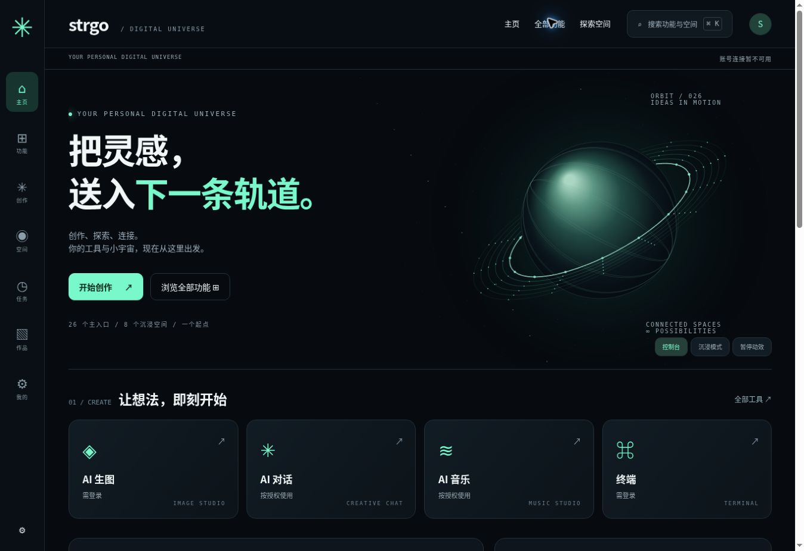

# 门户 v3.1 验收记录

日期：2026-10-23。环境：Linux、Node、Python，基于原 main `e1f0f5c` 的实现。验证的是本次源码与本地构建，没有发布生产站点。

## 自动检查

| 检查 | 结果 |
| --- | --- |
| `npm run build:production` | 通过，生产 vendor 完整 |
| `npm test` | 84 项 Node 测试、181 项 Python 测试全部通过 |
| `npm run test:ai` | Node AI 测试及 49 项 Python AI 专项通过；属于根回归的相关子集，不重复累计 |
| 生图/门户最后定向回归 | 31 项通过，包含新深链、退出清理和迟到响应隔离 |
| `python3 scripts/sync-hub-docs.py --check` | 注册表与文档一致 |
| `git diff --check` | 通过 |

新增覆盖：本人索引与管理员隔离；模块/模型撤权、到期和禁用；图像保存失败和生成失败分离；AI 核实中/未知状态；相同时间跨来源稳定分页；非法游标、来源、状态、数量；来源部分故障；音乐保留期限与待删除记录；只读聚合不生成任务；安全登录返回地址；按账号隔离的偏好；原任务参数复用不生成；账号切换期间旧请求不能写回界面；classic→hub→classic 构建切换与资源路径。

## 浏览器检查

使用真实浏览器打开本地构建，完成主页渲染、目录中文搜索、访客管理项过滤、收藏后刷新、共享切换器搜索/方向键/Esc、生图深色主题检查。桌面约 1365 px；手机用 390 px 和 320 px 的 iframe 检查响应式，记录的内容宽度/滚动宽度分别为 375/375 和 305/305，无整页横向溢出。修正了 320 px 的标题断行和按钮拥挤。

浏览器预览没有启动生产账号 API，因此明确显示“账号连接暂不可用”；没有填入模拟在线状态、任务、音频或作品。私有列表和动作的授权、分页与原模块行为由隔离测试数据库及原模块回归验证，不能当成生产账号联调。

## 尚未执行的环境验收

- 真实账号登录后的完整浏览器流程、实际云/本地文本和音乐模型、真实图片生成及持久化存储。
- Workflow 的真实 ComfyUI 执行和 AI/Workflow 共用 GPU 仲裁；本轮没有合并两条队列。
- 真机 iPhone/Android 软键盘与终端会话；终端仅新增入口链接，保留原交互。
- 独立空间全工程重建、Docker/SSH、生产 Nginx 部署和恢复演练。

部署前按统一部署流程完成以上与目标环境相关的验收。GitHub 提交不代表上述运行环境已配置，也不代表默认首页已切换。
